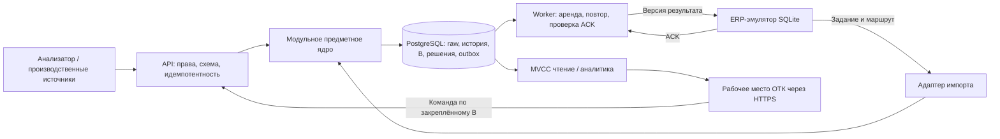

# EFQA — интеллектуальный контроль качества

Демонстратор для КосмоХакатона 2026: структурированные наблюдения анализатора,
производственные события и решения ОТК в проверяемой истории изделия.
**Текущая поставка — P8, API `/api/v2`, OpenAPI 0.5.0; внешний ERP-контракт 0.4.0.**
Данные синтетические, CV заменён эмулятором. Промышленная валидация не заявляется.

## Что показывает система

Изделие проходит входной контроль, обработку и сборку. Анализатор сообщает
признак дефекта. Контролёр видит сопоставимые осмотры до/после, операции и
обстоятельства, отдельно подтверждает дефект и назначает доработку. После нового
цикла контроля он фиксирует устранение и принимает решение о выпуске. Результат
сохраняется внешним ERP-эмулятором, ядро проверяет ACK.

Три ключевых свойства:

- **Основания «тогда/сейчас».** Решение ссылается на неизменяемый набор B; поздние
  события требуют пересмотра, но не переписывают прежнее решение.
- **Объяснимый запрет выпуска.** Одна оценка контрольной точки используется картой
  полноты и gate. Плохой контроль, неопределённая привязка и открытый дефект видны
  отдельно; восстановление выполняется авторизованными командами с аудитом.
- **Разделение сигнала, гипотезы и причины.** Дефект после операции не означает
  автоматически ошибку оператора. Аналитика показывает основания, неизвестные
  атрибуты и знаменатель сопоставимых работ.

## Быстрый полный запуск — PowerShell

Из корня репозитория. Нужны Python 3.11 и Docker Engine с Linux-контейнерами и
Compose. Первый build скачивает закреплённые образы и зависимости.

```powershell
py -3.11 -m venv backend/.venv
.\backend\.venv\Scripts\python.exe -m pip install -r backend/requirements.lock.txt
.\backend\.venv\Scripts\python.exe deploy/pilot.py up --directory .local/pilot --port 8443 --seed
```

Откройте **https://localhost:8443**. Локальный CA находится в
`.local/pilot/credentials/tls/ca.crt`; для браузера добавьте его в доверенные
корневые сертификаты тестового пользователя. Скрипт и healthcheck проверяют CA
автоматически. Токены `controller`, `master`, `integration` находятся в локальном
`.local/pilot/credentials/demo-tokens.json`. В интерфейсе введите токен и нажмите
«Загрузить изделия».

`--seed` принимает готовые события `data/v2/source-events.json`. Без этого флага
запускается импорт заданий ERP, но факты производства не создаются. Повторный
приём того же набора идемпотентен. API, PostgreSQL и ERP наружу не опубликованы;
единственная опубликованная точка — HTTPS на loopback.

```powershell
.\backend\.venv\Scripts\python.exe deploy/pilot.py verify --directory .local/pilot
.\backend\.venv\Scripts\python.exe deploy/pilot.py down --directory .local/pilot
```

`down` сохраняет том БД и локальные ключи. Полный регламент ротации,
backup/restore, TLS и границы профиля — [deploy/README.md](deploy/README.md).

## Архитектура



Одна транзакция связывает исходный факт, историю, предметное состояние и outbox.
Исходный JSON защищён AES-256-GCM; роли и append-only ограничения проверяются
отдельно. B и сообщения хранятся отдельно от компактного состояния. GET использует
согласованный snapshot без writer-lock; ACK не создаёт новую предметную версию.

Сильная альтернатива — SQL QMS с полноценным аудитом. Выбранная композиция делает
основания решения и пересмотр явными, ценой хранения снимков, версий и сложности
replay. Граф здесь означает связи данных, отдельная графовая БД не требуется.
Общий guard записи и полный replay истории изделия остаются ограничениями;
горизонтальный рост требует замеров. [ADR](docs/adr/001-core-architecture.md),
[модель оснований](docs/architecture/evidence-model.md),
финальное ревью.

## Реализовано и проверено в P7/P8

| Область | Проверенный результат |
| --- | --- |
| Полнота и recovery | Единая карта/gate; poor → repeat, bind непривязанного контроля; неизменность старого B, stale и точный retry |
| Аналитика | Когорта/период; дефекты по типу/линии/участку; отдельные виды/источники длительности; ошибки на сопоставимых операциях |
| Разбор и UI | Гипотезы до/после и ссылки на события; выбор записей; реальная ротация bearer с restart API после потерянного ответа, 401 старого токена и точный retry нового |
| Чтение и доставка | SQL-пагинация всех Page-списков, хронологический timeline/cursor; `sending`; чтение при занятом writer-lock; ACK без роста state |
| Полный браузерный путь | Chromium: normal release, A04 до persistent ERP ACK и реальная ротация credentials; всего 19 PASS |
| Эксплуатация | HTTPS с проверкой CA; restart с ключами v1/v2; backup/изолированный restore 12 raw, 23 B, 1 решения, 16 outbox; повторная доставка 16 сообщений |
| Разнесённые узлы | Четыре независимых Compose-проекта, HTTPS web→API и worker/importer→ERP, PostgreSQL verify-full, отдельные leaf-ключи. Проверены CA/SAN и запрет plaintext БД |
| Производительность | Реальные TCP/SQL замеры на 1/2/4 процессах API: ingestion/GET/ACK, рост хранения, очереди advisory locks; результаты и ограничения в P8 |

Итоговые проверки: **171 backend unit + 77 PostgreSQL + 27 contract/ERP +
14 frontend = 289 тестов**. Дополнительно прошли браузерный runner, pilot/TLS smoke,
Ruff, сборка frontend, обе генерации, shape-gates и `pip check`.
Команды, результаты и ограничения — [протокол P8](docs/architecture/p8-pilot-completion.md)
и исторический [P7](docs/architecture/p7-remediation.md).

## Повторение проверок

Backend, из `backend/`:

```powershell
.\.venv\Scripts\python.exe -m pytest -m "not integration"
.\.venv\Scripts\python.exe scripts/test_postgres.py
.\.venv\Scripts\python.exe -m ruff check . ../deploy/pilot.py ../deploy/check_pilot.py
.\.venv\Scripts\python.exe -m ruff format --check . ../deploy/pilot.py ../deploy/check_pilot.py
```

Контракты, из корня, в отдельном окружении инструментов:

```powershell
py -3.11 -m venv .local/contracts-venv
.\.local\contracts-venv\Scripts\python.exe -m pip install -r contracts/requirements.lock.txt
.\.local\contracts-venv\Scripts\python.exe -m pytest contracts emulator -q
.\.local\contracts-venv\Scripts\python.exe -m contracts.generate --check
.\.local\contracts-venv\Scripts\python.exe -m contracts.compatibility contracts/openapi.yaml contracts/compat-baseline.json
.\.local\contracts-venv\Scripts\python.exe -m contracts.compatibility contracts/external-openapi.yaml contracts/external-compat-baseline.json
```

Frontend, из `frontend/`, Node.js 24:

```powershell
npm ci
npm test
npm run build
npm run check:generated
npx playwright install chromium
```

Браузерная приёмка и проверка восстановления, из корня:

```powershell
.\backend\.venv\Scripts\python.exe backend/scripts/acceptance_demo.py
.\backend\.venv\Scripts\python.exe deploy/check_pilot.py
.\backend\.venv\Scripts\python.exe deploy/check_distributed_tls.py
.\backend\.venv\Scripts\python.exe deploy/check_multihost.py
.\backend\.venv\Scripts\python.exe backend/scripts/acceptance_demo.py --benchmark --api-workers 1
.\backend\.venv\Scripts\python.exe backend/scripts/acceptance_demo.py --benchmark --api-workers 2
.\backend\.venv\Scripts\python.exe backend/scripts/acceptance_demo.py --benchmark --api-workers 4
```

Проверочные скрипты создают изолированные стенды. Результаты и видео остаются в `.local/`.
Публикация предыдущего P6: [скринкаст и слайды](docs/demo/README.md).

## Границы и дальнейшее внедрение

Базовый пилот рассчитан на один Docker-host. Для нескольких машин подготовлен
[TLS-профиль](deploy/multihost/README.md), проверенный четырьмя изолированными
Compose-проектами через published ports; проверка физических сетей предприятия
ещё требуется. HTTP после завершения TLS остаётся только внутри узла.
Проекции содержат открытые метаданные. AEAD не доказывает полноту журнала и не
заменяет независимое хранение backup/manifest и управление доступом.

Межиздельный impact по фактическому составу остаётся отдельным экспериментом;
автоматический перенос старого контроля, промышленный edge spool, реальные
ERP/MES/CAD-коннекторы, PQ-криптография и нагрузочная приёмка — дальнейшие этапы.
19 PASS не означают полного закрытия всех подслучаев A01–A14. Независимое review
роли №2 и допуск предприятия не заявляются.

Следующий результат **роли №1**: по измерениям P8 сократить стоимость подготовки B
и replay; изменение общего guard — отдельное решение после межиздельных инвариантов.
**Роли №2**: независимая приёмка P8 и сверка
идентификации, маршрута и ограничений контроля с предприятием.

## Документы

- [Требования](docs/requirements.md) и исходные PDF в корне — постановка и критерии.
- [DP-01](docs/architecture/decision-protocol.md) и [P7](docs/architecture/p7-remediation.md) — предметные решения; [OpenAPI](contracts/openapi.yaml) — транспорт.
- [Производственный пилот](docs/architecture/enterprise-pilot.md), [камеры и ИИ](docs/architecture/camera-ai-design.md), [границы доверия](docs/architecture/trust-model.md).
- [Backend](backend/README.md), [эксплуатация](deploy/README.md), [P6/A01–A14](docs/demo/README.md).
- [Источники обоснования](docs/research/architecture-sources.md), [ранний архитектурный brief](docs/architecture-design-brief.md).

Ранние планы и отчёты P0–P6 сохраняют историю решений; актуальные запуск и статус
задаются этим README и протоколом P8.
