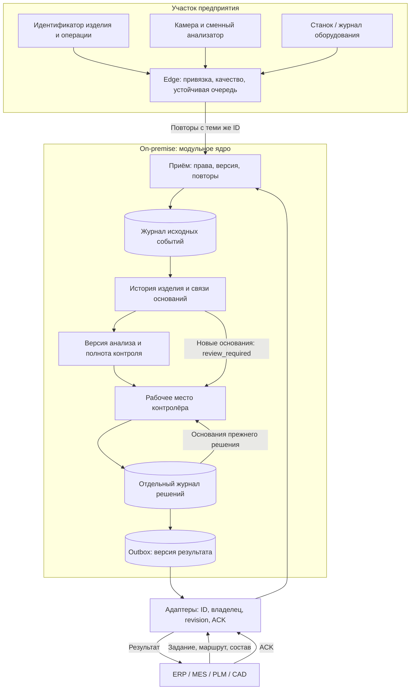

# EFQA: проверяемая архитектурная гипотеза

Статус: проектный эскиз для ADR и взаимного review. Это не описание работающего промышленного комплекса. Семантика событий остаётся в [contracts.md](contracts.md); предлагаемые метаданные оснований ниже требуют согласования до изменения API.

## 1. Центральный тезис

Система должна ответить на два разных вопроса: **«что мы знаем об изделии сейчас?»** и **«на основании чего контролёр принял решение тогда?»**. Изделие, наблюдение анализатора, гипотеза причины и решение человека имеют разные жизненные циклы.

Рабочая особенность EFQA — сочетание трёх механизмов:

| Механизм | Польза | Как проверим | Цена |
| --- | --- | --- | --- |
| Версионированный набор оснований решения | Можно восстановить знания на момент решения, даже после смены модели | Старое решение открывает прежние события, версии правил, маршрута и анализа | Хранение версий и миграции; одной временной метки недостаточно |
| Адресный пересмотр по зависимостям | Новое основание вызывает review затронутых решений и сборок | Поздний сигнал по компоненту помечает связанные решения, но не несвязанные изделия | Полнота связей, стоимость обхода, консервативный fallback при неизвестных связях |
| Карта полноты обязательного контроля | Отсутствие событий не превращается в годность | Пропущенная/неоценимая точка препятствует выпуску; видна конкретная причина | Требуется авторитетный маршрут и версия требований контроля |

Это инженерная композиция известных подходов, не доказанная мировая новизна. QMS с аудитом может обеспечивать те же свойства. Отличие нужно защищать конкретной моделью и сценарием, а не названием Evidence Graph.

## 2. Блок-схема

Блоки внутри ядра — логические модули, не отдельные микросервисы. Начальная реализационная гипотеза: реляционные таблицы событий, связей, решений и outbox в одной БД; API и обработчик доставки. Файлы наблюдений могут храниться отдельно, с контролем наличия, доступа, целостности и срока хранения. Ссылка на недоступное фото не считается доступным доказательством.

Приём raw event, обновление проекции и outbox сохраняют текущую атомарную границу из technical-decisions. Асинхронный replay при большом объёме — отдельный будущий ADR: потребуется явно показывать отставание проекции. Между отправкой наружу и ACK общей транзакции нет: повторы и идемпотентный получатель обязательны. У схемы нет канала управления приводами или защитными блокировками станка.

## 3. Почему такое устройство разумно

Сравнивать нужно независимые оси, а не «SQL против графа против микросервисов»:

| Ось | Варианты | Предварительный выбор и условие пересмотра |
| --- | --- | --- |
| Хранение истории | Текущее состояние + полный аудит; неизменяемые события и решения + проекции; полный Event Sourcing всех сущностей | Журнал свидетельств и решений, версии справочников и производные представления. Полный ES избыточен без необходимости replay всех команд; качественный аудит остаётся конкурентной альтернативой |
| Представление связей | FK/join-таблицы; обобщённые графовые рёбра в SQL; графовая БД | Типизированные SQL-связи с происхождением. Выделять графовую БД только после измерения сложных обходов и цены синхронизации |
| Развёртывание | Модульное ядро; несколько сервисов | Модульное ядро уменьшает распределённые отказы. Разделять при независимых SLA, командах или подтверждённом узком месте |
| Доставка | HTTP + локальная очередь/outbox; брокер | Первый вариант достаточен для пилота. Брокер при нескольких независимых потребителях или измеренном backlog; он не решает дубли, владение данными и причинность |

Граф означает отношения «наблюдение относится к компоненту», «решение основано на событиях», «версия замещает версию». Ребро `SUPPORTED_BY` не доказывает физическую причину. Если нужные вопросы решаются простыми join-запросами, дополнительный графовый сервис не нужен.

## 4. Разбор одного изделия

Синтетический пример из [first-slice.md](first-slice.md): `assembly-001`, вставка `insert-001`, обработка и сборка, один `mark-001` на `face-A`. Все времена ниже условные, UTC; стабильные ссылки дефекта принадлежат одному источнику.

| Шаг | Что произошло | Что можно утверждать |
| --- | --- | --- |
| 10:02 | Входной контроль: признаков нет, качество хорошее | В этой области и при этом методе признаки не обнаружены; выпуск ещё не разрешён |
| 10:08 | Станок сообщил отклонение во время сборки | Есть обстоятельство для расследования, но причина не установлена |
| 10:10 | Финальное наблюдение: признак `mark-001` | Есть кандидат несоответствия |
| 10:11 | Второе наблюдение того же признака; затем транспортный дубль | Два наблюдения одного дефекта; дубль ничего не добавляет |
| 10:12 | Контролёр подтвердил дефект и отдельно назначил доработку | Один подтверждённый дефект, причина `unresolved`, ошибок оператора 0 |
| 10:20 | Пришёл сигнал того же источника с `occurred_at=10:02:30`: признак существовал до сборки | Новая гипотеза входного происхождения; прежний анализ не отражал этот сигнал |

Предлагаемый набор оснований решения: ссылки на события и решения, версия маршрута/состава, версия правил и анализа, список неизвестных обязательных проверок. Версия модели берётся из наблюдений. Эти метаданные — проектное уточнение, не новые готовые поля v0.2.

Поздний сигнал добавляется в журнал. Пересчитываются затронутые связи и версия анализа; сохраняется прежнее решение с его основаниями. Выставляется `review_required`, наружу идёт новая версия результата с тем же бизнес-изделием и новым ID сообщения. Сам дефект остаётся одним, вина оператора автоматически не появляется. Контролёр принимает новое решение отдельно.

Адресный пересмотр требует индекса зависимостей. Если новая привязка неизвестна, нельзя гарантировать узкий охват: открывается задача разрешения связи и консервативно проверяется возможный круг изделий. Состояние «ожидаем подтверждения полноты» показывается явно.

## 5. Как внедрять на предприятии

| Этап | Метод | Кто участвует | Выход и условие перехода |
| --- | --- | --- | --- |
| Обследование | BPMN/SIPOC одного маршрута, инвентаризация сигналов и FMEA отказов | Технолог, ОТК, АСУ ТП, ИТ | Определены ID изделий, обязательные точки, владельцы данных и ручной порядок работы |
| Привязка данных | Таблица ERP/MES/PLM → канонические ID и версии; согласованный read-only обмен | Владельцы систем, интегратор | На выборке подтверждены идентичность изделия, состав и смысл времени; конфликты зарегистрированы |
| Теневой пилот | Параллельно штатному контролю, один участок, без автоматического выпуска | ОТК, технолог | Есть сверка с ручными результатами, полный журнал расхождений, проверка дубля/задержки/обрыва |
| Ограниченная эксплуатация | Решения уполномоченного контролёра, регламент деградации, обучение смены | Начальник качества, эксплуатация | Проверены резервирование и восстановление, ответственность за очередь review и передачу результатов |
| Расширение | Добавление участка через адаптер и версию маршрута | ИТ, АСУ ТП, ОТК | Измерены нагрузка и эффект пилота; новый участок не меняет правила существующего |

Конкретный способ подключения выбирается после обследования: документированный API/обмен файлами для ERP; доступный и согласованный интерфейс MES/SCADA, при наличии — OPC UA; для CAD/PLM — утверждённый экспорт состава и версии. Это варианты внедрения, не готовые интеграции. CAD задаёт проектный состав; фактически установленный состав должен подтверждаться производственным учётом.

### Ограничения и измерения

- Edge подтверждает локальный приём после устойчивой записи. Очередь конечна: при заполнении — сигнал оператору и переход к регламенту ручного контроля, без молчаливого удаления необработанного события.
- Расчёт буфера: `частота × средний размер × длительность разрыва × запас`, медиа отдельно. Например, проектное допущение 2 события/с × 4 KiB × 8 часов × 2 ≈ 450 MiB без фото, индексов и служебных накладных расходов. Фактические параметры измеряются на участке.
- Восстановление: скорость выгрузки должна превышать текущую генерацию; оценка времени разгрузки — `backlog / (скорость доставки − скорость генерации)`.
- AI: локальная выборка, подтверждение ОТК, разделение обучающих и проверочных партий, сравнение версий в теневом режиме, допуск технологом, откат. Confidence не является вероятностью истинного брака без калибровки.
- Метрики пилота: полнота привязки к изделию, число неоценимых проверок, возраст очереди, время поиска оснований, время пересмотра, пропуски/ложные тревоги на экспертной выборке. Целевые пороги согласовать с предприятием; экономию и точность заранее не обещать.
- RPO/RTO, сроки хранения событий/медиа и модель доверия администратору ещё предстоит согласовать. Append-only права приложения не защищают от администратора БД; шифрование не доказывает полноту архива.

## 6. Объяснение на защите

«Мы сохраняем отдельно сигнал, объяснение и решение. По изделию видно, что было известно контролёру в момент решения. Если приходит позднее свидетельство, система показывает, какие основания изменились и что нужно пересмотреть. Пропущенный контроль остаётся неизвестностью, а не превращается в выпуск. Для одного участка это можно реализовать модульным ядром и реляционной БД, затем расширять через адаптеры».

Основания для выбора digital thread и связи производственных данных: [NASA, NIST и отраслевые публикации](research/architecture-sources.md). Источники поддерживают подход, но не доказывают готовность или новизну EFQA.
