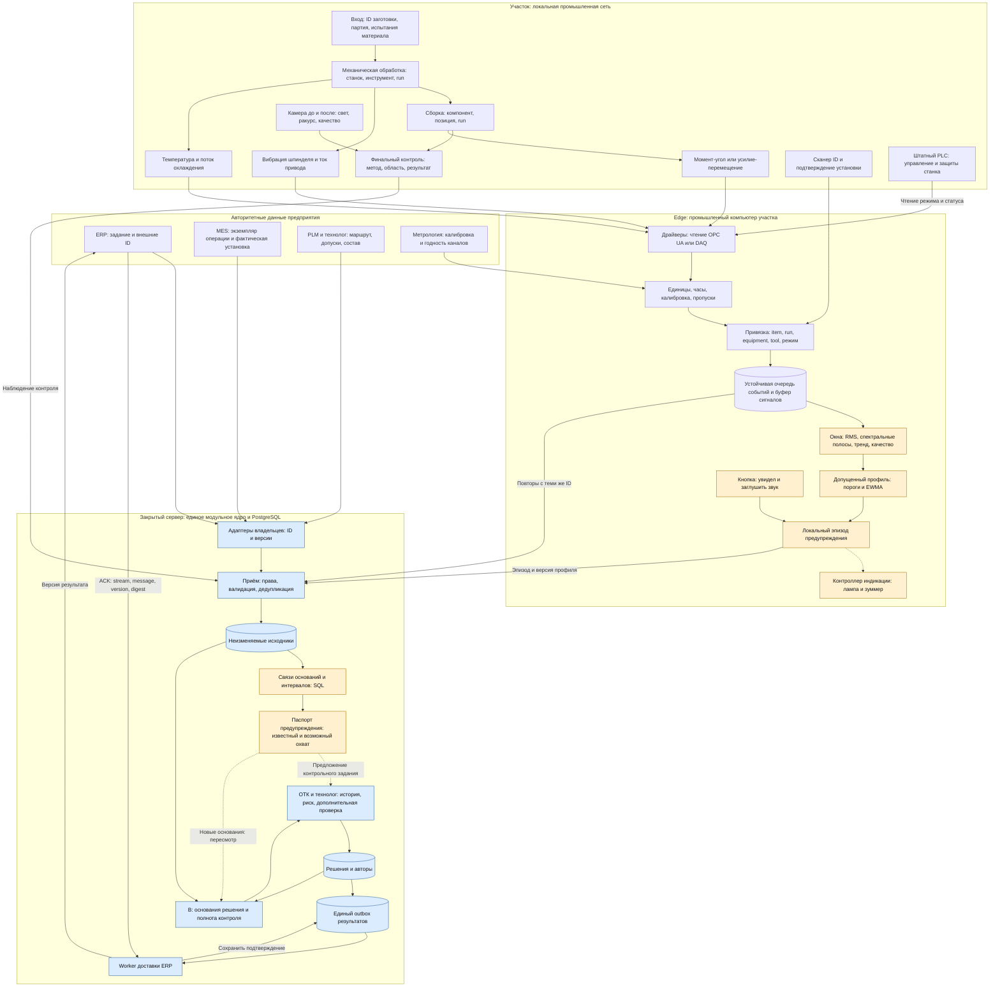
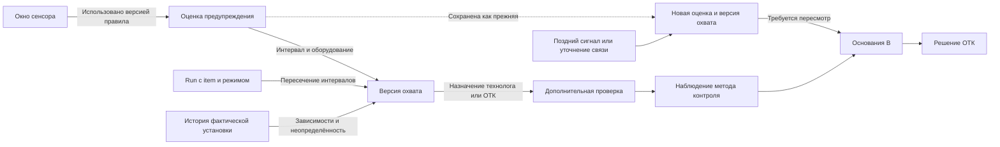
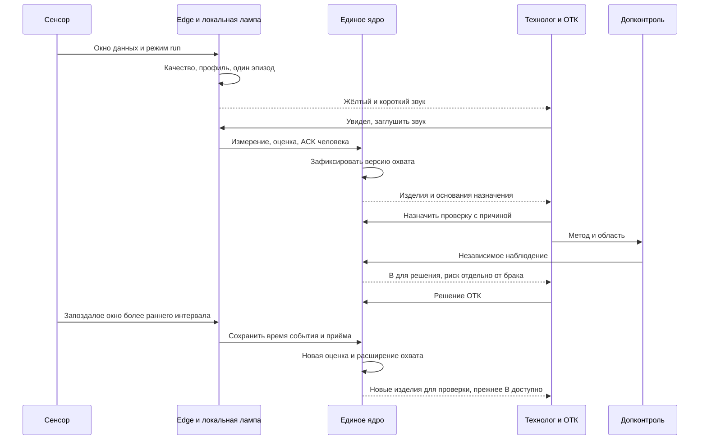

# EW-01: раннее предупреждение с проверяемым охватом изделий

26.09.2026, роль №2, новое поручение владельца проекта. **Статус: спроектировано,
предлагается на review роли №1.** Физические сенсоры, алгоритм предупреждений,
лампы/зуммер и новые команды не реализованы в P5. Пересчёт открытых данных реально
выполнен: [исследование и воспроизведение](../research/early-warning-findings.md).

## 1. Что улучшаем

Следим за двумя разными вещами:

1. **Предвестник:** режим процесса изменяется, но дефект детали ещё не наблюдался.
   Например, растёт вибрация при неизменной программе и подаче. Это риск и повод
   проверить инструмент/детали, а не подтверждённый брак.
2. **Существующий, ещё не найденный дефект:** повреждение могло возникнуть раньше,
   финальный контроль его ещё не обнаружил. Ранняя проверка сокращает задержку
   обнаружения, но не является прогнозированием появления дефекта.

Основание из постановки PDF: §1.1, стр. 3 — раннее обнаружение и предупреждение
повторного брака; §2.1 — проект комплекса. Предиктивные сенсоры и сигнализация —
наше расширение по поручению пользователя, не дополнительное обязательное требование PDF.

**Наше предложение для защиты:** «паспорт предупреждения» связывает измерения,
версию правила, режим операции, возможный круг затронутых изделий, назначенную
проверку и её исход. При позднем сигнале меняется круг проверки, но прежнее
предупреждение и решение остаются доступными. Название кратко: **от предвестника
до адресной проверки**. Это полезная композиция SPC, прослеживаемости и оснований
решений; мировая новизна не заявляется.

## 2. Детализированная схема размещения и потоков

Сплошные стрелки — данные/события, пунктир — предложенные назначения/индикация.
Синие блоки — опора на существующий P5; оранжевые — расширение EW-01; остальные —
целевое производственное окружение. Цвет не является доказательством реализации.
Межиздельные/партийные зависимости расширения не объявлены проверенными в P5.

**Физические границы:** высокочастотные сигналы обрабатываются на edge. В сервер
идут признаки, качество, привязки и ссылка на сохранённое окно исходного сигнала.
Доступ к ERP/MES через серверные адаптеры. Закрытый контур не нуждается в облаке.
Новые типы свидетельств входят в существующий приём/guard, а не в параллельное
предметное ядро. Граф — отношения в SQL; новая графовая СУБД не требуется.

## 3. Где поставить сенсоры и зачем

Ниже — инженерные гипотезы пилота, не вывод о частоте причин. Сначала использовать
доступную телеметрию, дополнительный датчик устанавливать при измеренной нехватке.

| Этап / механизм | Сигнал и место | Что можно заметить раньше | Проверка детали и ограничения | Владелец |
| --- | --- | --- | --- | --- |
| Вход: неподходящий материал/внутренний дефект | ID партии, протокол; по материалу — УЗК, твёрдость или иной допущенный метод | Несоответствие до затрат на обработку | Камера и сертификат не заменяют внутренний контроль; метод определяет технолог | ОТК/лаборатория, снабжение |
| Обработка: изменение состояния инструмента/колебания | Акселерометр на корпусе узла шпинделя; ток из привода, обороты, подача, tool ID | Отклонение от сопоставимого режима, возможный износ/вибрация | Измерение размеров/шероховатости; вибрация не доказывает конкретный дефект | АСУ ТП/ремонт, технолог |
| Обработка: охлаждение | Поток/давление у подачи СОЖ, температура в согласованной точке | Потеря охлаждения до накопления повреждений | Тепловая инерция, загрязнение и тип материала влияют на пороги | АСУ ТП/технолог |
| Сборка: крепёж/запрессовка | Кривая момент-угол инструмента либо усилие-перемещение пресса | Аномальный профиль установки до закрытия узла | «Момент достигнут» не доказывает требуемый преднатяг; нужна валидация соединения | Сборочный участок/метрология |
| Перемещение | Регистрация удара на таре, ID и интервал транспортировки | Повод проверить изделия после события | Общий датчик тары не устанавливает точное повреждённое изделие | Логистика/ОТК |
| Финал | Камера с фиксированным светом + размерный/иной нужный метод | Подтверждение качества, метка для оценки ранних сигналов | Это уже контроль результата, а не раннее предупреждение | ОТК |

Минимальная закупочная конфигурация определяется обследованием: 1 станок с
доступным током/режимом, 1 согласованный виброканал с DAQ, edge, сканер, сигнальная
колонна, кнопка и интерфейс обратного чтения выходов. Модель, стоимость, исполнение
и пригодность к месту установки пока неизвестны; «поставить датчик везде» не требуется.

**Проектная оценка ресурсов:** 3 оси × 25 600 отсчётов/с × 2 байта = 153 600 байт/с,
около 4,12 GiB за 8 часов без накладных расходов. Окно 10 с до + 10 с после эпизода
занимает около 2,93 MiB; 100 таких окон ≈293 MiB. Выбор частоты требует исследования
полосы частот и антиалиас-фильтра; эти числа — расчёт ёмкости, не спецификация станка.
Один пакет признаков 1 KiB/с даст ≈28,13 MiB/8 ч до индексов/запаса. Для окна события
нужна отдельная квота: потеря формы сигнала явно снижает полноту оснований, а не
маскируется существующей ссылкой. Размер конечной очереди и поведение при заполнении
согласуются с [edge-deployment](edge-deployment.md).

## 4. Предвестник не становится браком автоматически

Три независимые оси отображения:

| Ось | Примеры значений | Кто изменяет |
| --- | --- | --- |
| Состояние наблюдаемости | достаточна / нет данных / неверная привязка / неисправен канал | Проверки источника и связей |
| Предупреждение о процессе | нет отклонения / активное / увидено / возвращение в норму / закрыто с причиной | Правило + подтверждение/действие человека |
| Качество изделия | кандидат / подтверждённое несоответствие / устранено; отдельно pending/rework/released | Существующий процесс ОТК |

«Нет отклонения» разрешено только при достаточных свежих данных. Пропуск не означает
нормальный режим. Риск не увеличивает KPI подтверждённых дефектов и не разрешает
выпуск. Нужно ли конкретное предупреждение блокировать следующую операцию через
производственный регламент — отдельное правило технолога, а не побочный эффект цвета.

### Минимальный алгоритм для пилота

1. Пропуск/рассинхронизация/неверная калибровка → неизвестность, без значения 0.
2. Сегментация по программе, материалу, инструменту, режиму, версии маршрута.
   Разгон, холостой ход и резание не смешивать. Неизвестный режим → нет применимого профиля.
3. Физический предел из технологического регламента проверять отдельно от дрейфа.
4. Для допустимого канала считать EWMA: `z_t = λ·x_t + (1−λ)·z_(t−1)`.
   Базу, λ, пороги, длительность превышения и правило возврата версионировать.
5. Создавать один эпизод на equipment/channel/rule/run, а не новую тревогу на каждый
   отсчёт. Гистерезис и выдержка убирают дребезг; длительная тревога эскалируется.
6. Сохранять исходное окно, версию признаков/профиля и неизвестность. Текст объясняет
   наблюдаемое изменение; некалиброванный score не подписывать «вероятность брака».

EWMA — известный метод [NIST EW-S3](../research/early-warning-findings.md), а не
заявленная собственная разработка. Автокорреляция, смена режима и изношенный эталон
могут создавать ложные тревоги; пороги нельзя подгонять по проверочной партии.

## 5. Собственная композиция: паспорт предупреждения и адресный контроль

Предложенные сущности, **ещё не DTO общего контракта**:

| Сущность | Минимальное содержание |
| --- | --- |
| SignalWindow | source/event ID; оборудование/канал; единица/частота; интервал измерения; время приёма; неопределённость часов; калибровка; качество; ссылка/хеш исходника |
| WarningAssessment | ID/версия; предыдущая оценка; signal IDs; feature/rule/baseline versions; режим; значения/пределы; exclusions/unknowns; оценка без утверждения причины |
| ExposureSet | ID/версия; оборудование/интервал; точно/возможно затронутые item/run; связи и их версии; причины неизвестного охвата |
| CheckAssignment | предупреждение/охват; автор/причина; метод и область проверки; результат/решение либо ожидание; ссылки на B после включения в ядро |
| AlarmAction | episode ID; desired output/version/expiry; факт доставки/обратного чтения; отдельно acknowledgement пользователя и заглушение звука |

При неизвестной привязке показываем **возможный** охват: все runs, чьи интервалы с
учётом погрешности времени пересекают интервал сигнала на станке. Это консервативный
список на проверку, не список доказанно бракованных деталей. При неизвестной границе
интервала охват расширяется до согласованной смены/партии и остаётся незавершённым.
Историческая установка компонента проверяется на время операции, не по текущему составу.

Дедупликация сохраняет один эпизод; новая оценка не затирает предыдущую. Изменение
профиля не переписывает старую тревогу. Поздний архивный сигнал пересматривает
историю/охват, но не включает устаревшую физическую сирену как текущую аварию.

### Сравнение с сильной альтернативой

| Вариант | Польза | Цена/отказ | Когда выбрать |
| --- | --- | --- | --- |
| SCADA/SPC + QMS с полноценной прослеживаемостью и аудитом | Контроль режима, назначения, история — могут уже быть у заказчика | Нужно проверить единые ID, версии оснований и позднее уточнение охвата | Предпочесть настройку готовой системы, если она проходит тот же сценарий проще |
| **Модуль EW-01 в EFQA** | Явный паспорт раннего сигнала, охват и B «тогда/сейчас», один контур решений | Дополнительные версии/связи, калибровка, очереди тревог, эксплуатация | Наш пилот: требуется связать разнородные источники с единым решением |
| Сквозная ML-модель вероятности брака | Может учитывать сложные нелинейные признаки | Нужны репрезентативные метки, временная доступность, контроль дрейфа и объяснение | После накопления данных, если улучшение над правилами подтверждено на отложенных партиях |

**Проверяемое отличие:** на одном сценарии измерить время нахождения изделий для
допконтроля, число пропущенных затронутых и лишних назначений, возможность восстановить
старое основание. Если установленная QMS даёт это с меньшей стоимостью, реализовать
модуль в ней; если охват слишком неизвестен, сначала улучшить идентификацию.

## 6. Свет и звук: полезное действие, а не просто эффект

Проектная индикация подтверждается АСУ ТП с учётом принятого на предприятии значения
цветов. На экране обязательны текст/значок — информация не зависит только от цвета.

| Состояние | Предлагаемый выход | Ответственный и действие |
| --- | --- | --- |
| Данные свежие, отклонение не обнаружено | Зелёный постоянный: «мониторинг доступен», не «изделие годно» | Оператор продолжает по регламенту |
| Раннее предупреждение | Жёлтый мигающий + короткий звук при начале эпизода | Оператор подтверждает, мастер/технолог проверяет режим и назначает действие |
| Требуется срочная реакция по утверждённому правилу | Красный + отдельный ограниченный звуковой шаблон | Действие по местному регламенту; EFQA не управляет приводом |
| Нет обязательных данных/связи/исправной лампы | «Мониторинг недоступен», отдельный согласованный шаблон | Ручной контроль и заявка АСУ ТП; зелёный не оставлять |
| Тревогу увидели, причина ещё не устранена | Звук заглушён, визуальное предупреждение остаётся | ACK фиксирует автора/время, не закрывает проблему |

Управление лампой: аутентифицированный локальный адаптер → модуль дискретных выходов;
задаётся желаемое состояние с версией и сроком актуальности. Повтор команды не
создаёт повторный звуковой импульс одного эпизода. Устройство сверяет новое состояние,
после restart восстанавливает активные эпизоды; потеря питания не считается доставкой.
Без обратного чтения допустим только статус «команда отправлена», не «лампа горит».
Даже обратное чтение выхода не доказывает исправность излучателя — нужен регламент
теста лампы/зуммера и при необходимости физическая диагностика.

При обрыве центра локальные допущенные правила и индикация работают от edge;
события/ACK буферизуются. При истечении срока действия профиля или отсутствии данных
edge показывает недоступность. Очередь после восстановления не воспроизводит старые
звуки; центр получает всю историю. Переполнение очереди вызывает отдельный отказ
наблюдаемости. Новая критичность/длительное отсутствие реакции — отдельная эскалация,
не безостановочное повторение каждой секунды.

**Граница управления:** штатный PLC и существующие защиты станка самостоятельны.
Добавленная EFQA-сигнализация информационная. Автоматический останов потребовал бы
отдельного согласованного проекта АСУ ТП; в EW-01 команды управления приводом нет.

## 7. Последовательность и поздний сигнал

## 8. Проверка и передача роли №1

Следующий эксперимент — [синтетический сценарий EW-01](early-warning-demo.md).
До runtime-изменений роль №1 рецензирует сущности/транзакцию и решение, какие
предупреждения влияют на полноту контроля. Новые поля в OpenAPI/generated пока
не внесены; `machine_state` остаётся свидетельством оборудования, а не командой
создания подтверждённого брака.

| Владелец | Следующий результат |
| --- | --- |
| №2 | Передать схему, данные/выводы, численные допущения и проверочный пример; после review — отдельный симулятор сенсора/лампы и замер метрик пилота |
| №1 | Принять/изменить предложение WarningAssessment/ExposureSet, связь с B, права назначения/ACK, дедупликацию и поздний пересмотр; назначить редактора контракта |
| Технолог/ОТК | Выбрать один механизм отказа, применимые проверки, допустимое время реакции и пороги пилота |
| АСУ ТП/метрология | Доступные каналы/частоты, калибровка, монтаж и индикация, проверка потери связи/питания |

Условие пересмотра: если предупреждение не оставляет времени на действие, улучшать
расположение/метод измерения, а не объявлять его прогнозом; если много ложных тревог,
пересмотреть сегментацию и порог на отдельной выборке; если нет точного охвата,
улучшить учёт run/установок до автоматизации адресных назначений.
