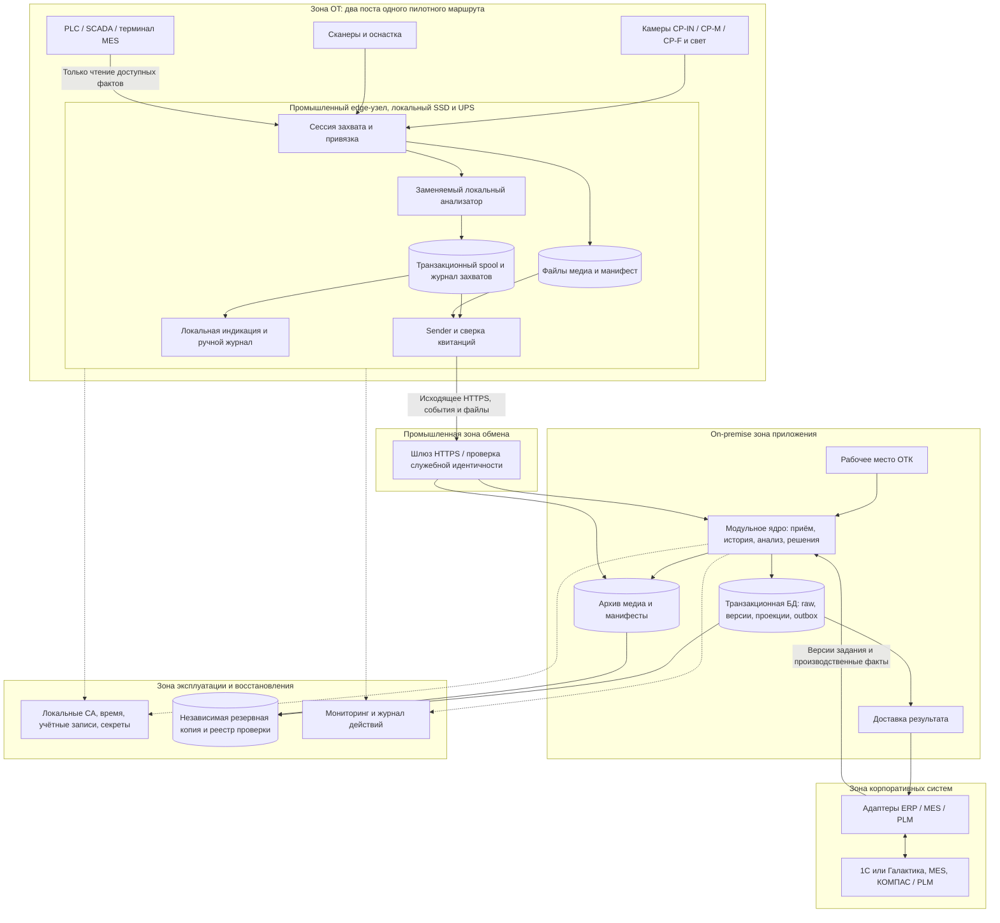
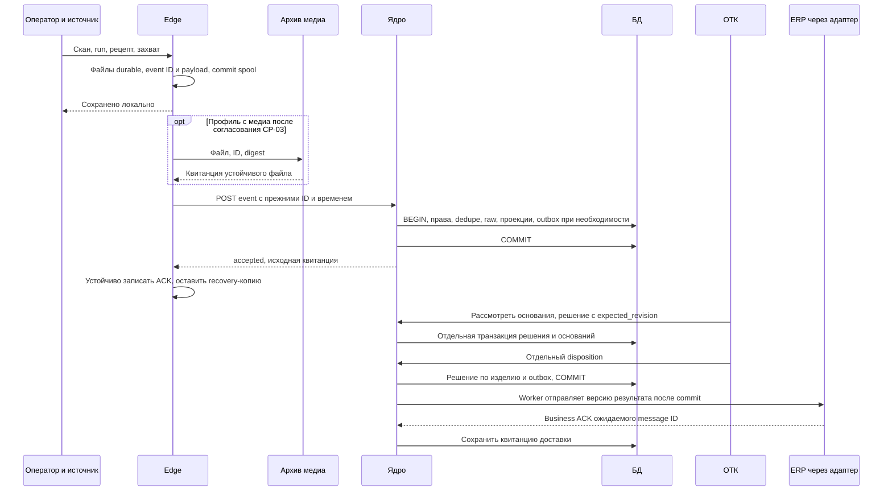
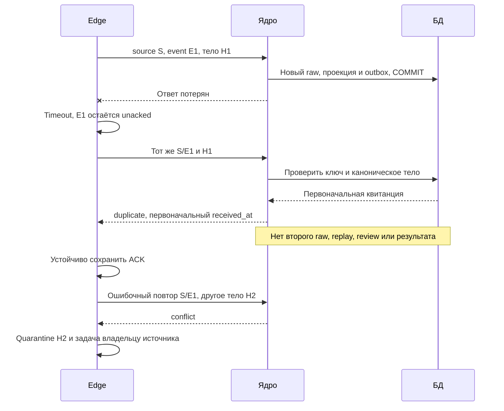
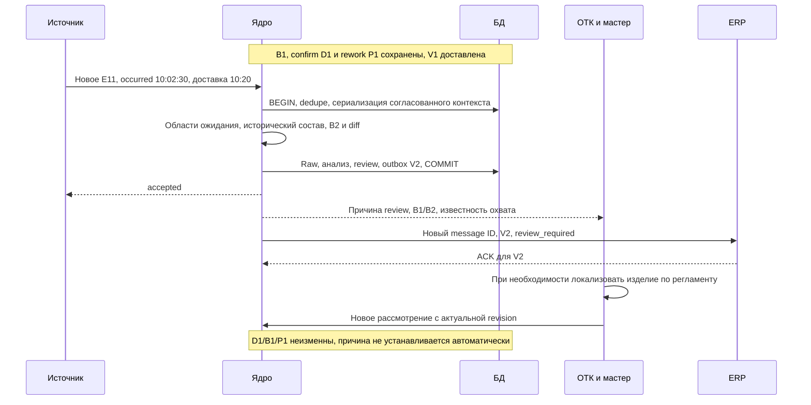
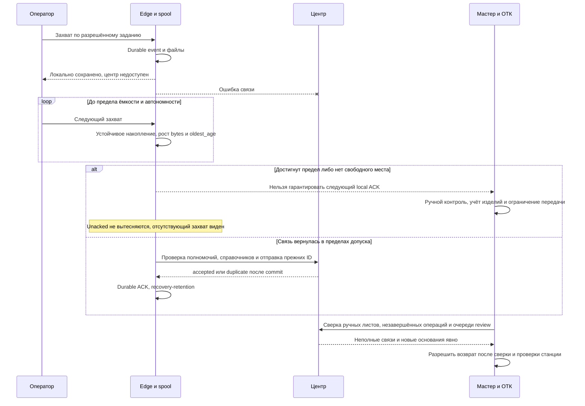

# Edge/on-premise: развёртывание, доставка и восстановление пилота

Дата: 25 сентября 2026. Владелец: роль №2. **Статус всех механизмов: спроектированы, не реализованы и не проверены этой поставкой.** Документ уточняет [enterprise-pilot.md](enterprise-pilot.md), не изменяет [контракт v0.2](../contracts.md). Пороговые значения и мощности — проектные допущения **Д**, не измерения предприятия.

## 1. Физические и логические границы

### 1.1. Deployment

Это зоны доверия и логические функции. Отдельный блок не означает отдельную VM или микросервис. В пилоте достаточно одного edge-узла на два поста при допустимых длинах/помехах линии; если сеть камер или расстояние этого не допускают, два независимых edge с тем же протоколом. Второй edge не является зеркалом неподтверждённой очереди первого.

**Отдельные роли состояния:** spool отвечает за локально принятый пакет до надёжного центрального приёма; БД — за принятый raw и решения; объектный архив — за байты файла; ERP — за своё применение результата. Шлюз не выдаёт бизнес-ACK по одному факту получения тела и не считается дополнительным журналом свидетельств.

### 1.2. Начальный состав и единичные точки отказа

| Узел | Проектный старт для измерений | Состояние / отказ / владелец |
| --- | --- | --- |
| Edge | Д: 4 CPU cores, 16 GiB RAM, не менее 256 GiB **доступной** SSD-ёмкости, промышленное питание и UPS | Очередь/медиа и рецепт; один SSD остаётся точкой потери. АСУ ТП обслуживает физику, ИТ — ОС/пакеты |
| Камеры | Три точки, характеристики из §3 пилота; проводной триггер/согласованный интерфейс | Нет подтверждённого кадра — пробел, а не отрицательный результат; АСУ ТП |
| Центральное приложение | Д: 4 vCPU, 16 GiB RAM; API и worker могут быть процессами одной VM | Перезапускаемые процессы без авторитетного in-memory состояния; ИТ |
| БД | Д: 4 vCPU, 16 GiB RAM, SSD по расчёту и замеру снимков | Единая транзакционная граница, WAL, backup. VM на том же host не защищает от отказа host |
| Медиа | Отдельная квота/том, начальная оценка в §5 | Объекты, digest, размер, retention; администратор архива |
| Backup | Другой failure domain и отдельные права; локально доступные ключи восстановления | Копия на том же диске не закрывает разрушение edge/host; ИТ + хранитель ключей |
| ОТК | Рабочее место с серверной аутентификацией; бумажный резервный комплект | Нет центра — нет фиктивной online-команды решения; ОТК |

Это ориентиры стенда, не доказанная минимальная конфигурация. GPU не обязателен: сначала измерить малый анализатор; при нарушении такта сравнить CPU-оптимизацию, GPU и центральный анализ. UPS обеспечивает время на завершение записи/остановку, но не гарантирует восьмичасовую работу; необходимая автономность питания измеряется отдельно.

### 1.3. Разрешённые сетевые потоки

| Инициатор → получатель | Назначение / предполагаемый протокол | Ограничение и проверка |
| --- | --- | --- |
| Камера/сканер → edge | Локальный интерфейс камеры/USB/Ethernet, зависящий от оборудования | Выделенная сеть камер; у неё нет маршрута в ERP/Интернет; проверить фактические порты поставщика |
| Edge → PLC/SCADA | Чтение выделенных тегов/журнала; OPC UA при поддержке, например TCP 4840 | Договор с АСУ ТП, лимит опроса; права только чтения, без команд приводам. Наличие OPC UA не предполагается заранее |
| Edge → шлюз → ядро/архив | HTTPS TCP 443, mTLS или эквивалентная согласованная служебная аутентификация | Allowlist узлов и source identity; размер/частота ограничены согласованной политикой; БД наружу не открывается |
| Рабочее место ОТК → приложение | HTTPS 443, персональная аутентификация | Права на решения отдельно от приёма raw; автора задаёт сервер |
| Адаптер → ERP/MES/PLM и ядро | Документированный API либо утверждённый защищённый файловый обмен | Разные учётные данные направлений; нет прямой записи адаптера в предметные таблицы чужой БД |
| Edge/серверы → локальные инфраструктурные службы | Время (например NTP UDP 123), DNS при необходимости, локальная PKI/реестр пакетов | Нет зависимости от внешнего DNS/NTP/облачной активации; адреса утверждает ИТ |
| Администратор → управляемый узел | Через выделенный management path/jump host по правилам предприятия | Журнал сессии, отдельная роль; рабочая станция камеры не становится маршрутизатором между сетями |
| БД/архив → backup; узлы → monitoring | Локальная резервная копия и метрики | Отдельные credentials; содержимое изображений/секретов не уходит в метрики |

Порты — предложение, не универсальная конфигурация firewall. При одностороннем шлюзе/data diode двусторонний HTTP/ACK невозможен: требуется отдельное решение о файловых пакетах, обратных квитанциях и сверке. Представлять текущую схему совместимой с ним без изменения протокола нельзя.

## 2. Устойчивая запись и ровно то, что подтверждает ACK

### 2.1. Локальная машина состояний

Названия ниже — **внутренние состояния доставки/захвата**, не статусы raw, observation или item в контракте.

`capture_reserved → capture_complete → event_durable → in_flight → core_ack_durable → retained → eligible_for_gc`

Боковые ветки: `capture_incomplete` при недополученном кадре; `quarantined` при повреждении/конфликте/неподдерживаемом формате. `in_flight` после рестарта снова допускает отправку **прежнего пакета**, не генерацию нового наблюдения. Карантин — сохранённый отказ с владельцем и квотой; это не accepted ядром.

1. До запуска захвата локально закрепляются capture ID, экземпляр/операция или явная неизвестность, рецепт, ожидаемое число кадров, источник и выделенный event ID. ID генерируется один раз в устойчивом журнале, не на каждой попытке HTTP.
2. Для внешнего источника с собственным стабильным ID сохраняется его ключ. Если идентификатора нет, edge может назначить свой ID факту локального приёма, но не способен надёжно распознать повтор того же физического сигнала после upstream-потери ответа. Такой источник требует протокола sequence/session или явной оговорки возможных дублей наблюдения.
3. Медиа записывается во временный файл; проверяются длина и digest; выполняются flush/fsync, переименование в финальное имя и устойчивое сохранение directory entry. Затем транзакция spool фиксирует манифест, окончательное неизменяемое тело события и ссылку на готовые файлы. БД spool должна иметь проверенный режим durable commit. Манифест не указывает на ещё не дописанный файл.
4. Только после этого выдаётся **local ACK** источнику/индикация «сохранено локально». При отсутствии медиа по допустимому профилю завершённость относится к пакету без фото. Если камера не поддерживает повтор/ACK, журнал ожидаемого захвата и счётчик кадров нужны для обнаружения потерь до этой точки.
5. Sender берёт только завершённые записи, отправляет неизменяемые source/event ID и тело. `occurred_at` остаётся временем захвата, не ретрая. Оригинальный принятый payload и каноническое представление для сравнения различаются по v0.2.
6. Ядро подтверждает только после commit raw + проекции + необходимого outbox согласно v0.2. Ответ `201 accepted` или `200 duplicate` содержит совпадающие source/event ID и первоначальную квитанцию; `projection_status=unresolved` означает сохранённый raw с неполной привязкой.
7. Edge устойчиво сохраняет квитанцию и отдельно статус файла. Сбой до её сохранения вызывает повтор, безопасный за счёт идемпотентности ядра. Удаление локального пакета не происходит просто после записи байтов в сокет.
8. Подтверждённый пакет переносится в ограниченный архив для сверки/восстановления (§5–6). GC учитывает сроки, сохранность файлов и открытые ограничения; unacked/quarantined не удаляются молча по возрасту.

**Цена:** транзакционный spool и файлы не имеют общей атомарной транзакции. Порядок «файл устойчив → манифест commit» оставляет при сбое возможные orphan-файлы. Recovery сверяет их с capture journal, сохраняет на разбор и не объявляет наблюдением лишь по имени файла. Не завершённый захват требует сверки/повторного контроля, а не автоматического достраивания результата анализатора.

**Граница гарантии:** local ACK означает сохранность после программного рестарта/проверенного отключения питания **при исправном носителе, ключах и честном durable storage**. Оно не гарантирует сохранность при пожаре/разрушении единственного SSD. RAID/UPS не заменяют независимую копию. Если предприятие требует RPO=0 при потере edge целиком, потребуется синхронная вторая копия до ACK и отдельный ADR с ценой/отказами.

### 2.2. Медиа и события: две разные квитанции

В v0.2 `evidence_refs` необязательны; endpoint загрузки/манифест и квитанция доступности ещё не определены. Следующее — **CP-03 для совместного решения**, не существующее API:

- Файл имеет устойчивый ID, размер, digest/алгоритм, источник, capture, время и точку; доступ через архив с авторизацией, не через произвольный URL из сообщения. Сервер не загружает непроверенные внешние адреса от источника.
- Передача идемпотентна по ID файла и digest. Незавершённая загрузка не публикуется как доступный объект. Для повторной передачи больших файлов нужен ограниченный resume либо повтор всего файла — выбрать после измерений; checksum проверяется после сборки.
- Предпочтительный online-путь — сначала устойчивый файл и квитанция архива, затем событие со ссылкой. В пределах локального spool есть связь пакета с файлом; межхранилищной распределённой транзакции не обещаем.
- Если архив недоступен, метаданные можно принять раньше файла только с явной доступностью «ожидается/недоступен» в предложенной модели. Контроль, которому требуется фото для решения, остаётся неполным. Переданный digest не доказывает, что файл можно открыть. Без согласованной модели CP-03 применять профиль без медиа для demonstrator либо держать весь требующий фото пакет локально.
- В ядре могут появиться orphan-объекты после принятия файла и отказа события. Reconciler проверяет манифесты, возраст и владельца перед очисткой. При потере файла после решения сохраняется прежняя ссылка и открывается оценка влияния.
- Raw ACK недостаточен для удаления последней локальной копии требуемого файла; нужны независимая квитанция архива и выполненное условие резервирования/retention. Подтверждение файла не заменяет raw ACK.

## 3. Доставка, справочники и время

### 3.1. Очередь и повторы

Д: один активный sender на spool; несколько источников обслуживаются справедливо, с ограничением на число одновременных запросов. При росте нагрузки изменяется транспортный адаптер, а не source/event ID. Очерёдность старается сохранять локальный порядок источника; глобальный физический порядок не обещается. Независимый late event не удерживается бесконечно за одним невалидным пакетом, но пропуск остаётся видимым и запрещает объявлять область полной.

| Ответ / ситуация | Действие sender | Чего не делать |
| --- | --- | --- |
| 201/200 и валидная квитанция | Устойчиво сохранить исходную квитанцию, продолжить сверку файлов | Не считать unresolved полнотой контроля |
| Timeout, reset, 503/5xx, 429 | Повторить с прежним ID/телом; учитывать Retry-After при наличии | Не присваивать новый ID, не считать отсутствие ответа отказом commit |
| 409: тот же ключ, другое тело | Карантин с обоими доступными digest и ответом; владелец источника разбирает | Не перезаписать исходное тело и не исправить его внутри прежнего ID |
| 422: версия/enum/тип/обязательное поле | Устойчивый локальный разбор; ошибка не успех | Не удалять пакет и не подавать бесконечно без исправления причины |
| 401/403 / неизвестный сертификат | Остановить отправку затронутого источника, уведомить эксплуатацию | Не переключаться автоматически на anonymous/HTTP |
| HTTP-успех с чужим ID, неверным телом квитанции | Протокольная ошибка, пакет остаётся unacked | Не очищать очередь по одному HTTP-коду |
| Нарушение целостности локального пакета | Изолировать пакет, зафиксировать пробел и область, сохранить доступные байты для расследования | Не пересоздать «тот же исходник» из текущей проекции |

Д для стенда: экспоненциальный backoff от 1 до 60 s с jitter, таймаут запроса 10 s; после серии неудач редкие проверки готовности. Ограничивается частота, а не сохранность события: истечение числа попыток не удаляет данные. Зависимость от переполнения/квот важнее бесконечного retry. Лимит размера пакета и скорость каждого источника утверждаются после замера; аномально большой пакет не должен занять резерв восстановления.

### 3.2. Offline-кэш контекста

Edge получает неизменяемый снимок разрешённых заданий/маршрута, маппинга, допущенных рецептов и справочника источников с версиями, сроком/областью разрешённой автономности. Начатая сессия закрепляет эти версии. Неизвестное задание нельзя автоматически допустить по похожему типу детали.

При локальном старте операции MES остаётся владельцем run. Предпочтение — заранее выданный допустимый run/диапазон идентификаторов и последующая сверка по договору MES. Альтернатива — резервный журнал с будущим отдельным разрешением связи; нельзя выдать произвольный edge ID за подтверждённый MES run. Это часть CP-01/07, а не уже готовое поле контракта.

После сети сначала сверяются отозванные/изменённые задания и ограничения, затем незавершённые операции; накопленные факты всё равно сохраняются как факты прежнего контекста. Новый справочник не редактирует старое тело в очереди. Несовместимая schema/analyzer version не исправляется перекодированием с прежним ID без отдельного решения об адаптации.

### 3.3. Часы и доказательство порядка

Локальный NTP/другой утверждённый источник времени обслуживает edge и серверы; состояние синхронизации проверяется перед захватом и сохраняется в журнале. `occurred_at` — время наблюдаемого события; если камера не даёт проверенного времени, используется момент локального захвата с известной задержкой и её ограничением. Это допущение метода, не точное время физического воздействия.

Д стенда: допустимое отклонение относительно локального сервера времени до 100 ms при исправной синхронизации. Для вывода «A раньше B» нужны интервалы неопределённости: `tA + uA < tB - uB`. Один флаг synchronized сам по себе не доказывает этот предел. Если неопределённость неизвестна/интервалы пересекаются, сортировка детерминированна, а причинный порядок неизвестен. Поля оценки `u` требуют CP-04; пока детали хранятся в эксплуатационном журнале метода и применяется консервативный вывод.

Во время offline дрейф накапливается. Для иллюстрации, 20 ppm × 8 h = 0,576 s **сверх** исходной ошибки; реальный ppm нужен из измерений и условий температуры. Возврат NTP не переписывает время уже принятых событий. Скачок часов/перезапуск помечает затронутые сессии uncertain. Монотонные часы пригодны для локального измерения интервала внутри одного запуска, но не задают UTC-порядок между станциями. `received_at` и время решения задаёт центр; времена доставки не подменяют длительность обработки.

## 4. Четыре последовательности

Все диаграммы — целевой протокол, не трассы работающего ПО. Ошибки и ручной регламент — §8 enterprise-pilot. Обозначение БД включает транзакционные таблицы, не хранилище файлов.

### 4.1. Normal: от скана до отдельного решения

### 4.2. Duplicate: commit состоялся, ответ потерян

### 4.3. Late: новые основания после решения

При unknown-охвате требуется явное ограничение области CP-02; диаграмма не обещает, что такое ограничение уже реализовано. При ошибке/лимите синхронного replay транзакция полностью откатывается, accepted нет, пакет остаётся у edge. Общий guard из предложения роли №1 отдельно согласуется.

### 4.4. Offline/reconnect и переполнение

## 5. Ёмкость, ресурсы и время разгрузки

### 5.1. Допущения на весь пилот, а не на каждую камеру

| Величина | Д для расчёта | Что замерить |
| --- | --- | --- |
| События всех источников | λe = 2 event/s постоянно, среднее тело 4 KiB | Среднее/p95/max, пики machine logs, canonical/encrypted overhead |
| Захваты | λc = 0,1 осмотра/s **суммарно по трём CP**, два кадра на осмотр | Пиковую одновременность и повторный контроль; не складывать разные трактовки частоты |
| Медиа | 2 MiB на сохранённый кадр | Формат и степень сжатия; исходные 5 MP могут быть больше, число не следует из разрешения |
| Длительность разрыва | T = 8 h = 28 800 s | Максимум предприятия, связь и питание отдельно |
| Запас объёма | F = 2 | Включает вариацию нагрузки, но не безграничный поток |
| Накладные расходы | he = 2 для spool/индексов/WAL, hm = 1,2 для файлов/манифестов | Замер фактического режима WAL/GC, шифрования и файловой системы |
| Разгрузка | μe = 20 устойчивых event commit/s, μm = 4 MiB/s полезных файлов | С replay и шифрованием, а не только пустой HTTP; конкуренция актуального потока |

**Уточнение §2.1:** [camera-ai-design.md, §7](camera-ai-design.md) отдельно рассчитывает сырой кадр: 2448×2048×8 bit = 4,78125 MiB. При сохранении таких кадров вместо предполагаемых 2 MiB расчёт unacked media с теми же запасами даёт около 64,55 GiB за 8 h — больше выделенных ниже 64 GiB. До выбора профиля файлов нужны измерение сжатия без потери значимых признаков и пересчёт всех media/recovery-квот, центрального архива и разгрузки; приведённый далее бюджет не является универсальным для raw-кадров.

Для нескольких edge частоты распределяются по узлам; общий центр обязан принять сумму. При удвоении частоты камер расчёт пересчитывается до расширения. Если нет подтверждённого ограничения входной интенсивности, конечный диск не даёт гарантированной длительности offline.

### 5.2. Расчёт

`event_spool = λe × event_bytes × T × F × he`

- Уникальных событий за разрыв: `2 × 28 800 = 57 600`.
- Только тела: `57 600 × 4 KiB = 225 MiB`.
- С запасом 2 и overhead 2: **900 MiB ≈ 0,879 GiB**. Пример brief 450 MiB учитывал запас, но не накладные расходы; противоречия нет.

`media_spool = λc × frames_per_capture × frame_bytes × T × F × hm`

- `0,1 × 2 × 2 MiB = 0,4 MiB/s`.
- За 8 h: `11 520 MiB = 11,25 GiB`.
- С F=2 и hm=1,2: **27 GiB**.

Д доступной ёмкости edge: 8 GiB для metadata/spool/WAL/quarantine, 64 GiB для unacked media, 128 GiB для подтверждённого recovery-архива, 32 GiB для ОС/пакетов/ограниченных логов; минимум 24 GiB свободного резерва, всего **256 GiB usable**. Диск с маркировкой «256 GB» меньше 256 GiB и не удовлетворяет этому плану. Размер устройства выбирается по реальной доступной ёмкости, ресурсу записи и условиям эксплуатации, не по названию.

Внутри metadata-квоты резервируется 1 GiB для состояния восстановления/аудита инцидента; карантин ограничен отдельной квотой 1 GiB. При насыщении карантина новые непринимаемые пакеты получают отказ, источник обязан сохранить свой экземпляр; для камеры без такого механизма фиксируется пробел и прекращается пилотный захват. Нельзя бесконечно «сохранять всё» вне рассчитанной квоты.

**Подтверждённый архив отдельно:** Д минимальное локальное хранение 24 h после центрального ACK. За сутки: metadata `0,659 GiB × he=2 ≈ 1,318 GiB`; медиа `33,75 GiB × hm=1,2 = 40,5 GiB`; вместе **41,82 GiB** без фактора всплеска. После reconnect в эти 24 h по времени ACK дополнительно попадёт до 8 h старого backlog: расчётная верхняя оценка `41,82 × (24 + 8) / 24 ≈ 55,76 GiB`, при двойной нагрузке **111,52 GiB**. Поэтому выделены 128 GiB, а не только две суточные нормы. При 85% эксплуатация уже включает ручной режим/разбирает рост; 111,52 GiB ещё ниже 95% предела 121,6 GiB. Для двух сдвоенных разрывов, задержанного backup или более долгого retention нужен новый расчёт. Эти байты нельзя одновременно считать свободным live-spool.

При перемещении из spool в recovery-архив сначала устойчиво фиксируются подтверждение и новая принадлежность квоте, затем разрешается освобождение прежнего места. Если тома разные, копия проверяется до удаления оригинала; временное двойное размещение учитывается в резерве. Сбой в момент переноса не должен приводить к утрате обеих копий или потере их ID. Повтор после потерянной квитанции не продлевает retention исходного ACK бесконечно, кроме явного нового инцидента восстановления.

При восстановлении скорость должна быть выше текущего входа:

`drain_time = backlog / (μ − λ)`

- События: `57 600 / (20 − 2) = 3 200 s ≈ 53,3 min`.
- Медиа: `11 520 / (4 − 0,4) = 3 200 s ≈ 53,3 min`.
- При двух независимых потоках это нижняя оценка около 53 min; при общей последовательной обработке/конкуренции может приблизиться к сумме или быть выше. Проверочная цель пилота **менее 2 h** включает протокольные накладные расходы и требует измерения.
- Полезные 4 MiB/s — около 33,6 Mbit/s без TLS/сетевых накладных расходов. 100 Mbit/s номинально не гарантирует эту скорость через реальный шлюз и архив.
- Если μ ≤ λ, очередь не разгружается: увеличение диска только откладывает отказ. Нужно уменьшить поступление по согласованному процессу либо увеличить измеренную пропускную способность.

### 5.3. Пороги и смысл «осталось N часов»

По каждой квоте отдельно измеряются занятые/свободные байты, inode, доступный резерв, самый старый unacked, скорость поступления и оценки времени до заполнения. Срабатывание берётся по худшему ограничению, включая минимальное физическое свободное место и ошибки записи, а не по усреднению дисков.

Д порогов: 70% — предупредить эксплуатацию; 85% — мастер готовит/включает ручной режим; 95% или невозможность зарезервировать полный следующий пакет — запрет нового пилотного захвата и отказ local ACK. Это программная политика приёма, не команда аварийной остановки станка. Уже зарезервированный пакет завершается только в своём выделенном объёме; неограниченная запись поверх резерва запрещена.

Иллюстрация media-квоты 64 GiB: при 70% остаётся 19,2 GiB. При базовом расходе с hm `0,48 MiB/s` это около 11,38 h, при двойном — 5,69 h. При 95% остаётся 3,2 GiB, около 1,90 h на базе; этот резерв нужен для завершения и восстановления, а не разрешение ещё два часа бесконтрольного производства. Фактический прогноз пересчитывается по верхней оценке текущей нагрузки и инциденту диска.

Неподтверждённые данные не вытесняются по схеме ring buffer. Диагностические логи могут ротироваться по отдельной квоте; журнал свидетельств и ручных оснований этой политике не подчиняется. Backlog после отказа ядра из-за большого replay может исчерпать буфер даже при исправной сети — это тот же производственный отказ.

### 5.4. Центральное хранение и стоимость

Д непрерывного 24/7 потока даёт нижнюю оценку: `172 800 событий/сутки`, `0,659 GiB/сутки` raw-тел; медиа `33,75 GiB/сутки` до overhead. За 30 суток медиа около **1 012,5 GiB ≈ 0,989 TiB**, с hm — **1 215 GiB ≈ 1,187 TiB**. Одна дополнительная полная backup-копия удваивает это до 2 430 GiB; временная staging-копия/версионность и свободное место добавляются отдельно.

Метаданные за 90 суток: около 59,33 GiB только тел или 118,65 GiB при he=2, **без проекций, B и снимков анализа**. Их размер может доминировать: нельзя умножать один event_bytes на всё ядро. Для бюджета измеряются средний размер B, число версий на изделие, исторический состав, outbox, WAL, retention и восстановление. Квадратичный рост полных снимков из ADR роли №1 — отдельный риск.

Проектная цена включает станции/свет/оснастку, edge и запасной носитель, обслуживание/калибровку, сеть/UPS, центральные и резервные диски, лицензии API, хранение ключей, время ОТК на review. Денежные суммы без предложений поставщиков и времени персонала не вычисляются. Пилот сравнивается с настройкой уже имеющейся QMS на тех же критериях.

## 6. Retention, backup и восстановление

### 6.1. Предварительная политика — на согласование с предприятием

| Класс | Д для ограниченного пилота | Важная зависимость |
| --- | --- | --- |
| Edge unacked/quarantine | До успешной доставки/явного разрешения инцидента; ограниченная ёмкость | Возраст не даёт права удалить; при нехватке места ручной режим |
| Edge подтверждённая recovery-копия | Не менее 24 h после ACK и до подтверждения достаточного центрального backup | Если backup не подтверждается и архив заполнен, это новый инцидент; нельзя молча сократить срок |
| Центральные raw, решения, B, версии контекста, маппинга и ACK | Весь пилот, предварительно минимум 90 суток и до завершения review/приёмки | Производственный жизненный цикл может требовать годы; 90 дней не отраслевой норматив |
| Центральные обычные медиа | Д 30 суток при отсутствии более долгой зависимости | Материал, использованный в B/открытом расследовании, сохраняется не меньше связанного основания; ожидаемое продление учитывается в диске |
| Версии анализатора/правил/рецептов | Пока нужны связанные основания и возможность воспроизведения | Версия-строка без исполняемого пакета не обеспечивает replay; лицензия/зависимости тоже архивируются |
| Ключи расшифрования и публичные данные проверки | Не короче срока защищённых данных плюс необходимое восстановление | Ротация не удаляет старые ключи; ключи отдельно от копий данных, но совместимость сверяется |

Удаление по сроку — авторизованная процедура архива с проверкой ссылок/удержаний, манифестом и записью факта удаления. Если предприятие требует бессрочную доступность оснований, политика 30/90 суток заменяется до допуска. Потеря медиа не исправляется удалением ссылки из старого B.

### 6.2. RPO/RTO и честная граница

Предварительные цели учений:

- **Канал/центр offline 8 h:** RPO=0 для local-ACK пакетов при исправном edge/ключах, если не превышены нагрузка и ёмкость. Это не гарантия RPO=0 всей системы.
- **Перезапуск edge:** Д RTO 30 min до проверенного приёма; local-ACK очередь восстановима на исправном диске. Потеря диска во время offline может уничтожить весь неподтверждённый диапазон.
- **Центральный disaster restore:** Д RPO до 15 min по проверенной цепочке backup/WAL, RTO до 4 h до доступного ядра, затем сверка/ОТК до возобновления выпуска. Требуется отдельный failure domain; периодический checkpoint без проверенной доставки WAL этого не гарантирует.
- Edge-копия может восполнить входные события центрального потерянного диапазона, но **не** решения контролёров и внешние side effects. Для них нужен центральный журнал/backup и сверка ERP. Поэтому 24 h edge-retention не превращает центральный RPO в ноль.

Д: полная копия БД ежедневно, непрерывное архивирование WAL с контролем возраста не более 15 min, архив медиа/манифестов с не худшим согласованным RPO. Подтверждение recovery-копии должно обозначать восстанавливаемую согласованную границу, а не один успешный job при отсутствующих файлах/ключе.

### 6.3. Runbook восстановления

1. Эксплуатация объявляет инцидент, фиксирует scope/последний известный commit/backup, запрещает параллельную работу старого и восстановленного writers. Мастер и ОТК включают ручной регламент; доставка outbox временно приостановлена.
2. В изолированной среде восстановить ключи и доверенные версии ПО, затем БД до выбранной точки, версии контекста/правил и файлы по манифестам. Проверить digest/AEAD и доступность выборки старых оснований, не только «БД стартовала».
3. Сопоставить журналы edge и восстановленный ledger по source/event ID, а также медиа по ID/digest. Пакеты из потерянного центрального диапазона отправить с прежними ID. Уже имеющиеся дадут duplicate. Поле received_at восстановленной квитанции не может само доказывать прежний commit, если запись потеряна — инцидент и история восстановления должны это явно показывать.
4. Отдельно сверить решения и outbox с пользователями/резервными журналами и ERP. ERP могла применить версию, которую восстановленная БД уже не содержит; запрещено автоматически отправлять старый released или повторно исполнять бизнес-действие. Восстановить исходный результат из доверенной копии/аудита либо оформить явное новое рассмотрение с пробелом истории.
5. Перестроить производные представления согласованными правилами, сохранив исторические решения/B; проверить incomplete, unresolved, открытые ограничения и пропущенные файлы. Не делать replay текущими правилами вместо утраченного старого артефакта и не объявлять его воспроизведением.
6. ОТК сверяет состояние физически удерживаемых/переданных изделий с результатами. Владелец ERP подтверждает актуальные версии/неисполненные задачи; эксплуатация восстанавливает отправку и наблюдает очередь.
7. Записать измеренные RPO/RTO, недоступный диапазон, восстановленные ID, источники копий, остаточные ограничения, ответственных и решение о возврате. Если потеря неустранима, остаётся видимый пробел и дополнительный физический контроль, а не «0 потерянных» по числу строк новой БД.

## 7. Доверие и защита

| Угроза / граница | Проектный контроль | Что этим не доказано / проверка |
| --- | --- | --- |
| Чужой источник выдаёт себя за станцию | Индивидуальная служебная идентичность, привязка к разрешённым source ID/типам; mTLS/авторизация | Подлинная камера всё ещё может сообщить ложный факт; проверить запрещённый source_id |
| Источник пытается принять решение | Раздельные endpoints/роли, человеческий автор из серверной сессии | Admin не получает автоматически полномочия ОТК; проверить запрет controller_decision во входе |
| Перехват/подмена сети | TLS на разнесённых компонентах, локальная CA, проверка срока/цепочки | TLS не гарантирует долговременную неизменяемость или истинность наблюдения |
| Кража диска/backup | Шифрование raw и медиа, защищённое хранение ключей; проекции/логи тоже классифицируются | Шифрование всего диска не защищает от вошедшего администратора; метаданные остаются чувствительными |
| Изменение пакета | AEAD с управляемыми nonce/ключами, проверяемый manifest для файлов | Простая checksum рядом с изменяемым файлом не защищает от администратора, способного поменять оба |
| Удаление raw/истории | Append-only права приложения, аудит, независимые контрольные манифесты/backup | Администратор БД/host может обойти права; требуемое доверие и независимость хранения определяет роль №1 |
| Потеря/ротация ключа | Реестр key ID/version, отдельная копия и учения восстановления старого пакета | Новый ключ не расшифрует старые данные автоматически; отсутствие ключа — недоступность доказательства |
| Злонамеренный файл/модель | Локально проверенный пакет, подпись/хеш, изолированный rollout и минимальные права анализатора | Подпись подтверждает происхождение, не отсутствие ошибки; откат и повторная оценка обязательны |
| Скомпрометированное время/кэш | Локальный доверенный источник, quality и журнал изменения, закреплённые версии | Синхронизация не гарантирует физическую последовательность при перекрытии интервалов |

Секреты не включаются в сообщения, образы, git и примеры. Сертификаты/ключи выдаются через локальную процедуру ввода станции, права ограничиваются source identity. При истёкшем/неизвестном сертификате отправка блокируется, сбор в пределах локальной ёмкости может продолжаться с явным состоянием доверия. После ротации нельзя менять source ID/тело старого события лишь ради обхода дедупликации. Обработка накопленных сообщений от отозванного источника требует расследования; их нельзя автоматически считать доверенными после получения нового сертификата.

Отзыв во время отсутствия связи невозможно мгновенно узнать локально. Нужно определить допустимую автономность credentials и способ доставки локальных списков отзыва. Это предел системы, а не причина отключить проверку TLS. Идентичность и подлинность прошлого события требуют собственной модели происхождения; один действующий клиентский сертификат sender не доказывает время создания кадра.

Долгосрочный/постквантовый профиль не реализован. Наличие этой таблицы не закрывает критерий криптографической реализации; конкретный профиль, nonce/rekey/подписи и независимые контрольные точки должны быть приняты в trust-модели роли №1.

## 8. Наблюдаемость, нагрузка и расширение

Минимальные метрики: `capture_expected/completed/incomplete`, локальные durable события, accepted/duplicate/conflict, unresolved, bytes/free/inodes по каждой квоте, oldest unacked age, retry/ACK age, локальный fsync/commit latency, свободное место backup, clock uncertainty, анализатор/рецепт, media pending/unavailable, время replay и ожидание блокировки, outbox age, число/возраст review. Метрики сверяются с множеством ID — разница счётчиков сама по себе не находит потерянное событие.

Технические логи используют request/capture/event/message ID, код ошибки и версию, но не секреты/полный payload/изображение. Аудит действий и решений хранится отдельно от ротируемых диагностических логов. В локальной панели видны связь, последний успешный приём, ёмкость, актуальность задания и неоценимые точки; центральная панель показывает возраст данных, а не выдаёт последний статус за текущий при потере связи.

| Рост / узкое место | Что меняется | Проверка перед заявлением свойства |
| --- | --- | --- |
| Больше камер | Edge compute, IO, квоты, версии рецептов; при необходимости отдельные edge по постам | Совместные пики, power-cut, ID/области, суммарная нагрузка центра |
| Медиа занимает канал | Независимый поток файлов/квота, ограничение конкурентности, другой архив | Метаданные не голодают, incomplete media явно, backlog реально убывает |
| Длинная история/общий guard | Индексы, политика снимков, измерение B и replay; отдельное решение по concurrency | Нагрузка с поздними событиями и общей связью, а не только независимые пустые item |
| Несколько workers | Общая БД, уникальные ключи, согласованный lock/guard для всех writers | Нет двойного учёта и потерянной зависимости при независимых соединениях |
| Брокер Kafka | Sender/ingestion transport adapter, topic/partition policy, offsets, ACL/retention и dead-letter handling | Broker ACK не заменяет commit ядра; повтор после commit/offset crash, порядок по предметной области, restore |
| OpenTelemetry | Инструментация портов захвата/приёма/replay/доставки, локальный collector, exporter, sampling и redaction | Отказ collector не останавливает приём; trace ID не заменяет evidence ID; чувствительные данные не экспортируются |

Общий транзакционный guard из `a1e8d87` может сделать μe=20 недостижимой при большой истории. Расчёт §5 — требуемое проверяемое условие, а не обещание throughput. Если оно не выполняется, роль №1 выбирает оптимизацию или отдельный ADR асинхронного replay с явной неполнотой; роль №2 пересчитывает буфер и допустимую автономность. Добавление Kafka не исправляет перегруженный синхронный reducer.

**Следующий результат №1:** подтвердить/скорректировать границы ACK, media/B, общий guard и restore решений. **Следующий результат №2:** измерить входной профиль и полезную скорость, проверить потерю питания/ответа, пересчитать квоты и согласовать физический ручной режим с предприятием. До этого все таблицы и последовательности остаются проектом.
