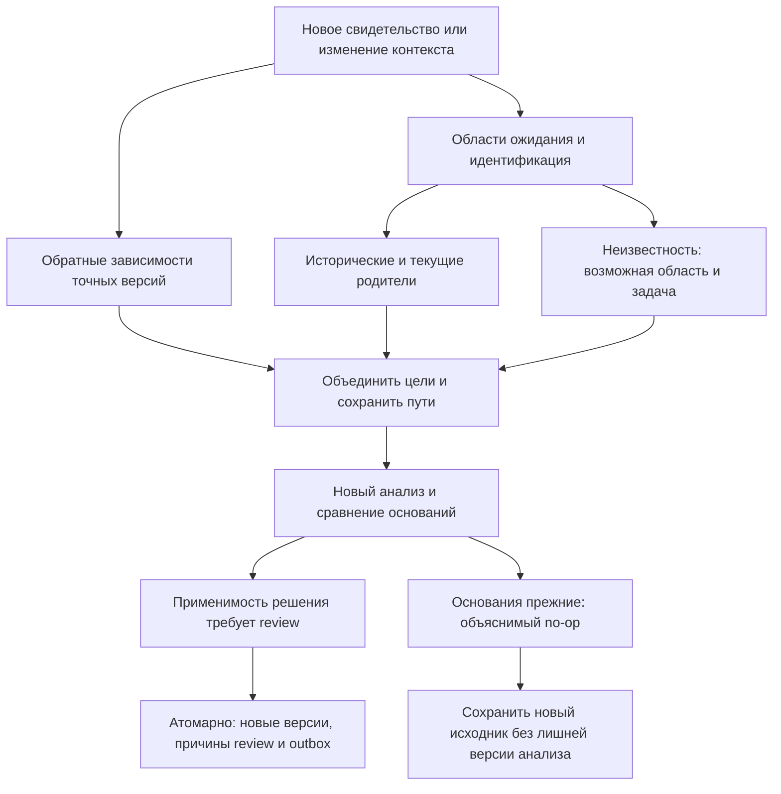

# Evidence Graph: адресный пересмотр и объяснение влияния

Дата: 25 сентября 2026. Роль №1, GPT Astra. **Статус: спроектировано, предложение для review роли №2; полный протокол не реализован.** Часть поиска по составу проверена в отдельном [синтетическом эксперименте](impact-experiment.md): 25 тестов, 384 сравнения с полным перебором; это не проверка транзакций, B, review и outbox. Документ уточняет ось B [ADR-001](../adr/001-core-architecture.md) и §4 [модели оснований](evidence-model.md). Все новые сущности ниже — семантическое предложение, не изменение v0.2, OpenAPI или действующей транзакции backend.

## 1. Вопрос и выбор

Как по новому свидетельству найти решения, основания которых могли измениться, включая сборки с этим компонентом, и объяснить каждое попадание? Нельзя пропустить факт лишь потому, что его не было при принятии решения. Нельзя объявить остальные изделия независимыми при неполном составе.

| Вариант | Когда разумен | Цена / контрпример |
| --- | --- | --- |
| Пересчитать весь участок | Небольшой пилот или неизвестный круг изделий | Простая полнота охвата, но очередь ОТК засоряется; связь причины пересмотра с изделием всё равно нужна |
| Обратный индекс только использованных оснований B | Изменение доступности известного материала или исправление уже использованной связи | Новый R11 отсутствует в B1: поиск вернёт пустой результат |
| **Явные зависимости + области ожидания + история состава** | Известные экземпляры, подтверждённые владельцы связей | Дополнительные индексы, версии и консервативные срабатывания; неполнота связей требует расширения охвата |

**Предложение:** третий вариант; первый — явный fallback. Результат поиска разделяет «основания изменились», «возможно затронуто» и «исключено в проверенной области». Это категории объяснения, не новые статусы дефекта. Адресность не означает математически минимальное множество: первый пилот предпочитает лишний review пропущенному влиянию.

**Условие пересмотра выбора:** если подтверждение состава/областей стоит дороже полного пересчёта маленького участка, оставить полный пересчёт с тем же объяснением. Если очередь ложных срабатываний мешает ОТК, сужать правила только по подтверждённому технологом интервалу/циклу и проверять против широкого эталона.

## 2. Семантика связей

Идентичности RawEvent, Observation, DefectCandidate, B, AnalysisVersion, ControllerDecision и ItemDisposition заданы в модели оснований. `Component` — роль экземпляра в составе другого экземпляра, а не его тип. Связь по одинаковому типу компонента не означает общий физический экземпляр.

| Связь / направление | Происхождение | Правило использования при поиске |
| --- | --- | --- |
| `OBSERVED_ON`: наблюдение → экземпляр/область | Надёжная идентификация источника либо отдельное разрешение привязки | Запускает поиск по экземпляру; uncertain даёт возможную область, а не достоверный факт |
| `PART_OF`: компонент → фактическая сборка | Версионированное утверждение MES/производственного учёта с основанием | Обход вверх по фактическому и историческому составу; CAD-проект отдельно |
| `DURING_OPERATION`: событие → OperationRun | Точный ID и проверенная привязка либо кандидатное сопоставление | Точный ID допускает адресный поиск; совпадение времени само не подтверждает связь |
| `EXECUTED_FOR`, `USES_EQUIPMENT`, `PERFORMED_BY`: операция → изделие/оборудование/оператор | Производственные события с известностью связей | Оборудование и интервал помогают найти кандидатов; общий оператор сам не распространяет дефект на все изделия |
| `ORDERED_BY`: изделие → WorkOrderVersion | Импорт и ID-маппинг | Смена применимого задания запускает поиск по потребителям этой версии/области |
| `PRODUCED_BY_ANALYZER`: наблюдение → AnalyzerVersion | Поле источника, unknown сохраняется | Общая модель не распространяет обычный дефект; отдельное уведомление о проблеме версии находит её потребителей |
| `BEFORE / AFTER`: наблюдение ↔ операция | Производное отношение, версия правила и входы | Только сопоставимые области и надёжные времена; не ребро доказанной причины |
| `SUPPORTED_BY / CONTRADICTED_BY`: анализ → наблюдение | Результат конкретного анализа | Оба вида входят в основания; обход только этих рёбер недостаточен |
| `USES`: B → точная версия события/связи/контекста/решения | Манифест B | Обратный индекс находит зависимые наборы, включая использовавшие отвергнутое основание |
| `WATCHES`: область анализа → область новых входов | Версия правил отбора и требований контроля | Ловит новый факт, а также ранее отсутствовавшую обязательную проверку |
| `REVIEWED_BY`: карточка → решение; решение → B | Авторизованная команда | Пересмотр относится к актуальной применимости решения, исходная запись неизменна |
| `SUPERSEDES`: новая версия → прежняя | Команда владельца данных/контролёра | Историю сохраняет; новый анализ не замещает человеческое решение |

Для типизированной SQL-модели нужны отдельные отношения с FK к допустимым типам целей, а не одна бесконтрольная таблица `(from, to, type)`. B может ссылаться на другой B: это направленная ациклическая зависимость версий. Гипотезы и противоречия могут образовывать другую структуру; их нельзя смешивать с деревом физического состава.

### 2.1. Утверждение состава и два времени

Предлагаемый состав утверждения: ID версии, `component_id`, `assembly_id`, владелец, ссылка на источник, фактический интервал `[valid_from, valid_to)`, известность границ, версия ID-маппинга, время регистрации, ссылка на исправляемое утверждение. Открытый конец означает «конец не зарегистрирован», а не доказанное вечное нахождение в сборке.

Удаление из сборки и исправление ошибочной принадлежности различаются. Первое завершает физический интервал, второе уточняет ранее сообщённую историю. Оба добавляют запись; старый B продолжает ссылаться на прежнее утверждение. Конфликт владельцев или одновременная установка одного сериализованного компонента в две сборки остаётся неопределённостью, а не выбором последнего сообщения.

**Две ловушки времени:**

1. Ранний дефект компонента может затрагивать сборку, в которую компонент установили позже. Условие `occurred_at` внутри интервала установки пропустит такой случай.
2. Снятие компонента не доказывает исчезновение его влияния на прежнюю сборку: возможны повреждение сопряжения и уже принятые решения. Обход только текущего состава пропустит историческую зависимость.

Поэтому начальная политика **impact-v1 — весь известный жизненный цикл экземпляра**: вверх по всем принятым историческим и текущим фактическим связям, включая исправленные утверждения для поиска старых потребителей. Времена показываются в объяснении, но без утверждённого правила не используются для отсечения. Такой охват означает необходимость оценки, не наличие дефекта во всех найденных сборках. Ремонт/снятие сами не обнуляют влияние. Обозначение P1 по-прежнему относится только к решению rework из модели оснований.

Историческое объединение рёбер может содержать цикл даже при корректных отдельных снимках; обход ведёт `visited`. Цикл в одновременном фактическом составе — ошибка данных: остановка повторного обхода плюс задача разрешения и неполный охват. Несколько путей к одному изделию не создают несколько дефектов или заданий review.

### 2.2. Индексы зависимостей и неизвестности

| Проектное отношение | Что хранить | Индекс / назначение |
| --- | --- | --- |
| Версии фактического состава | Утверждения из §2.1, включая историю | Компонент → родители; сборка → компоненты; точная версия → потребители |
| Зависимости B | Точная ссылка, роль входа, версия правила | Использованная сущность/версия → B → решения |
| Области анализа | Цель, экземпляр, применимый маршрут/цикл, ожидаемые точки, политика охвата | Экземпляр → активные анализы; точка/операция → ожидания |
| Кандидатная область неопределённости | Основание, список или предикат участка/партии, известность охвата, владелец разрешения | Поиск конфликтующих команд выпуска, включая появившиеся позже изделия |

`WATCHES` создаётся даже если наблюдений пока ноль. Неизвестный маршрут — явный пробел, а не пустой список точек. Для impact-v1 область наблюдений — всё изделие; сужение по `defect_ref`, классу дефекта, положительности сигнала или времени не применяется. Иначе новый отрицательный/неоценимый сигнал может быть ошибочно пропущен.

Полнота связей не выводится из наличия одной строки состава или `identification_status=reliable`. Для исключения независимого изделия нужно основание полноты: владелец подтвердил состав и историю привязок в рассматриваемой области/версии; известны границы выгрузки и нерешённые конфликты. Отсутствие такого подтверждения расширяет возможный охват. Формат подтверждения и его производственная проверка входят в review роли №2.

**Два разных вида неизвестности:** null `component_id` не объединяет дефекты по wildcard (v0.2); при поиске влияния он расширяет возможную область проверки. Поиск изделий для review не является алгоритмом слияния карточек и не увеличивает `confirmed_defects`.

## 3. Вход и результат поиска

**Вход:** новое принятое свидетельство, исправление/новая связь, активация применимой версии контекста либо изменение доступности используемого доказательства; точные ID изменений, прежний и новый контекст. Транспортный дубль завершается до запуска поиска. Новая связь обязана искать и ранее принятые свидетельства компонента — иначе сигнал, пришедший до сведений о сборке, потеряется.

**Результат — объяснение влияния** (предлагаемая внутренняя модель):

- ID изменения и версия политики impact-v1;
- цели пересчёта и актуальные решения, требующие review;
- для каждой цели: ID исходника, версии связей и цепочка до цели;
- разница B: добавленные входы, уточнённые связи/версии, противоречия, полнота и ограничения;
- полнота охвата: известен / ограничен известным кругом / круг неизвестен, с основанием;
- открытые задачи разрешения; проверенные исключения в пределах запрошенного набора изделий.

Пример пути: `R11 → insert-001 → membership-M1 → assembly-001 → WATCHES W-A1 → B1/D1/P1`. Причина пересмотра: «появилось ранее недоступное наблюдение до операций». **Это не путь физической причины дефекта.**

Для `assembly-002` допустимо «не затронуто данным изменением при составе G1 и политике impact-v1», если проверены состав, зависимости и отсутствие применимой открытой неопределённости. «Нет пути в графе» без этих условий означает лишь «путь не найден».



## 4. Алгоритм и правила завершения

Ниже псевдокод проектного алгоритма; это не исполняемый backend.

```text
1. Под сериализацией команды проверить повтор и конфликт тела.
   Повтор -> исходная квитанция. Конфликт -> отказ без изменений.
2. Прочитать согласованные старый контекст, активные цели и области.
   Построить новый контекст с изменением, не изменяя старые версии.
3. Собрать seeds:
   a. надёжно идентифицированные цели события;
   b. потребителей изменённых точных оснований;
   c. обе стороны прежней и новой привязки/применимости.
4. Найти замыкание вверх по историческим и текущим PART_OF в impact-v1.
   Для каждой новой связи включить существующую историю компонента.
   Добавить потребителей B/решений и области WATCHES найденных целей.
5. Добавить возможные цели по uncertain-привязке, конфликтам и пробелам.
   Для новых возможных целей также выполнить замыкание шага 4,
   сохраняя кандидатный характер пути; повторять до исчерпания новых целей.
   Если круг не доказан полным -> сохранить открытое ограничение области.
6. Для каждой цели пересчитать контекст, основания и анализ.
   Сравнить предметные входы/версии/неизвестность, не computed_at.
   Если поменялись основания актуального решения -> причина review.
   Продолжить по зависимым B/решениям до неподвижной точки.
7. Атомарно сохранить raw/утверждения, новые версии, зависимости,
   причины review, задачи неопределённости и необходимые outbox-сообщения.
   Commit -> квитанция. Старые B и решения сохранить без UPDATE.
```

Исторические решения тоже доступны в отчёте о новых знаниях, но замещённое решение не создаёт отдельную активную работу ОТК, если ни один актуальный результат от него не зависит. При транзитивном использовании старого решения актуальным disposition пересмотр распространяется на этот disposition.

Одинаковый вывод анализа не означает прежнее основание. Новый принятый вход в области impact-v1 меняет B даже при прежнем `confirmed`; прежняя человеческая оценка автоматически не переносится. No-op допустим при действительно неизменных предметных основаниях, например повторном техническом replay или изменении вне области применимости. Сравнение не зависит от времени запуска/нового случайного ID снимка.

**Очередь review:** отдельные причины по `(цель решения, изменение, новая ревизия контекста)`, одна отображаемая открытая задача на актуальную цель с набором причин. Новый контролёрский просмотр фиксирует, какие причины и какую ревизию рассмотрели. D2 не снимает автоматически review с P1: disposition должен опереться на актуальные решения отдельной командой. Новое параллельное основание не теряется при закрытии старой причины.

**Неизвестность:** если возможный круг известен, помечаются эти изделия; если известен лишь участок/партия, сохраняется ограничение по этой области и задача владельцу. При полностью неизвестном круге область пилота остаётся непроверенной. Проверка `released` учитывает открытый предикат области, а не только текущий список item ID: новое изделие на затронутом участке тоже проходит эту проверку. Это проект контроля выпуска в EFQA; команды станку или автоматического отзыва из ERP здесь нет. Регламент ОТК/ERP требует ответа роли №2.

После разрешения привязки пересчитываются **прежняя возможная область ∪ новая установленная область**. Кандидатные предупреждения могут закрыться с объяснением, но это не новое решение «годно» и не автоматическое снятие других причин review.

## 5. Конкуренция, падение и ограничение обхода

Новый межиздельный поиск нельзя просто вставить перед существующим per-item lock. Между выборкой родителей и блокировкой изделия может появиться новая связь. Блокировки только найденных строк не защищают от отсутствующего ребра или нового потребителя.

| Вариант сериализации | Цена | Предложение |
| --- | --- | --- |
| **Один транзакционный guard ядра пилота** для всех меняющих контекст команд | Сериализует и независимые изделия, ограничивает throughput | Простой эталон для первого ограниченного эксперимента |
| PostgreSQL SERIALIZABLE и повтор всей транзакции | Нужно проверить все предикаты, ошибки сериализации, идемпотентность повторов | Кандидат после измерения эталона |
| Разделяемый барьер топологии + упорядоченные блокировки объектов | Сложнее: новые зависимости, состав, маршрут и области неопределённости должны следовать одному протоколу | Следующий ADR при необходимости параллельной обработки |

**Предложение только для будущего эксперимента:** транзакционный advisory lock с одним документированным ключом на БД пилота. Его до чтения состояния берут все изменяющие команды: приём, решение, состав/маппинг, активация маршрута, разрешение неопределённости и replay. Изменяемые внешние `latest` не читаются: сначала импортируется неизменяемая версия. Порядок — guard → ключ идемпотентности → объекты в стабильном порядке. Ошибка/rollback освобождают guard; внешний HTTP выполняется после commit. Старый writer без guard нельзя одновременно подключать к этому эксперименту.

Для этого варианта сохраняется READ COMMITTED: получение guard — отдельный SQL-запрос, все предметные чтения выполняются следующими запросами после захвата. Тогда ожидавшая команда видит commit предыдущей. Снимок REPEATABLE READ, открытый до ожидания, не является равноценной заменой этого протокола. Чтение карточки для UI должно возвращать согласованные B и ревизию одного снимка; при записи актуальность перепроверяется под guard.

Это сознательно более грубая граница, чем реализованный per-item lock; **не изменение текущего backend и не утверждение горизонтального масштабирования**. Guard обеспечивает согласованность только при выполнении протокола всеми writers и не защищает от администратора БД.

| Порядок конкурентных действий | Допустимый исход |
| --- | --- |
| Сначала R11, затем решение со старой ревизией | `stale_revision`; решение не записано |
| Сначала решение D1, затем R11 | D1 сохранено; R11 создаёт новую версию и review |
| Сначала наблюдение компонента, затем его установка | Установка читает прежнее наблюдение и включает новую сборку в оценку |
| Сначала установка, затем наблюдение | Наблюдение видит установленную связь и включает сборку |
| Сбой до commit | Нет частичного raw/состава/анализа/review/outbox, accepted не отправлен |
| Потеря ответа после commit | Повтор возвращает прежний результат, не создаёт вторую задачу/версию |

У обхода конечное множество версий и `visited`; циклы не означают бесконечную работу. Ограничение времени/числа посещений — предел ресурса, не условие «остальные независимы». Для первого синхронного эксперимента при превышении предела откатывается вся команда, источник сохраняет её в очереди; оператор получает явную ошибку и задачу расширить ресурс/разобрать данные. Число предела и отображение ошибки согласуются до реализации. Частичный commit под `accepted` запрещён. Фоновый пересчёт с ограничением выпуска требует отдельного решения о durable-job и отставании проекций.

## 6. Синтетические входы для ручного review

Все ID, времена, связи и интервалы — **условные данные**, не производственная валидация. Ожидаемые результаты вынесены в [impact-review-cases.md](impact-review-cases.md); каждое изменение ниже применяется к указанной базе независимо, если явно не дана последовательность.

### База F0

- Трасса R1–R10, B1/D1 и BP1/P1 для `assembly-001` из §5 модели оснований. Область W-A1 — всё изделие и его компоненты, P1 — rework, причина дефекта unresolved.
- `insert-001 → assembly-001`, утверждение M1, установка с 10:07, принадлежность подтверждена производственным источником. Входные наблюдения компонента до 10:07 связаны с будущей сборкой по заданию. Это проектное допущение, а не вывод из времени.
- Независимая `assembly-002` содержит `insert-002` (M2). Её обязательные проверки выполнены, нет открытых несоответствий; D-A2 обозначает отдельное решение released с B-A2. Она использует тот же тип маршрута и анализатора, но другой экземпляр компонента.
- Состав обеих сборок и область задания проверены полными для примера, общих используемых решений и открытых неопределённостей нет. Общая неизменившаяся версия маршрута не является изменением.

| Вход | Изменение относительно базы |
| --- | --- |
| F1 | F0 + R11 из модели: входной сигнал `mark-001`, occurred 10:02:30, received 10:20, `item_id=assembly-001`, component insert-001 |
| F2 | F0 + отдельное наблюдение RC по `item_id=insert-001` с надёжной идентификацией; 10:02:30 / 10:20, признак до установки |
| F3 | F1 + точный транспортный повтор R11; отдельно — повтор с изменённым телом и прежним ключом |
| F4 | F0 + сборка `assembly-003`; в 10:30 insert-001 снят из assembly-001, в 10:40 установлен в assembly-003; затем получен RC с occurred 10:02:30 |
| F5 | F0 + исправление: M1 ошибочно связывало insert-001 с assembly-001; новое утверждение M3 связывает его с assembly-003. Старое M1 остаётся в B1 |
| F6 | F0 + uncertain-наблюдение U1, возможные изделия assembly-001 и assembly-002; затем отдельное разрешение привязки только к assembly-001 |
| F7 | F0 + U2 без установленного изделия, известен лишь участок S; затем регистрируется новое assembly-004 на участке S и запрашивает released |
| F8 | Отдельная база: RC уже принят для insert-001, сборка неизвестна; позже приходит M1 с принадлежностью assembly-001 |
| F9 | F0 + вложенная связь assembly-001 → module-001 (M4); решение P-M по module-001 использует BP1/P1; затем R11 |
| F10 | F0 + цикл одновременного состава assembly-001 → insert-001 при M1; отдельно запуск с искусственно малым лимитом обхода |
| F11 | F0 + активация route@2 только для будущих заданий; отдельно — активация с явно заданной применимостью к обеим существующим сборкам |
| F12 | F0 + независимый сигнал только по insert-002; отдельно — поздний `not_assessable` по обязательной точке assembly-001 |

F2/F4/F8 проверяют распространение влияния, **не** автоматическое объединение RC с `mark-001` сборки: ключ кандидата v0.2 включает item_id. Для слияния нужна отдельная обоснованная связь. В F1 тот же полный ключ позволяет сохранить один дефект.

## 7. Цена и предел доказательства

При индексах поиск затрагивает посещённые узлы V, рёбра E и найденные зависимости K: графовая часть O(V + E + K) плюс стоимость индексных обращений. Replay историй выбранных изделий — отдельная стоимость; для полного пересчёта примерно сумма O(nᵢ log nᵢ) плюс предметные проверки reducer (см. ADR-001). impact-v1 в худшем случае охватывает весь участок. «Адресный» не означает постоянное время.

Индексы требуют порядка O(E + K + W) записей сверх raw, где W — области ожидания. Полные манифесты B и снимки могут расти квадратично за жизненный цикл; медиа не копируются. Для объяснений достаточно графа предшественников и одного воспроизводимого пути к каждой цели, а не перечисления всех возможных путей (их число может быть экспоненциальным). Сортировка ID делает объяснение стабильным.

Измерить в эксперименте: число посещений/целей, долю расширенного охвата, время поиска и replay, ожидание guard, размер B, число причин и возраст очереди review. Проектные наборы — цепь вложенности, широкий состав, много исторических перестановок, unknown; значения SLA задаются пилотом. Метрики сокращения ручного расследования требуют сравнения с работой ОТК, их пока нет.

Связь с источниками: [S1/S2](../research/architecture-sources.md) поддерживают прослеживаемость производственной истории и внимание к семантике обмена; [S5](../research/architecture-sources.md) — происхождение и версии сущностей. Политика impact-v1, индексы и guard — решения команды; источники не подтверждают их производственную оптимальность.

## 8. Передача роли №2 и следующий эксперимент

| Вопрос | Предложение №1 | Что должен подтвердить №2 |
| --- | --- | --- |
| Фактическая установка/снятие | Версия утверждения, владелец, исходник, интервал и known/unknown; CAD отдельно | Источник фактического состава и способ обнаружить его неполноту |
| Позднее уточнение ID | Отдельная связь, поиск по старой и новой областям | Кто вправе разрешать конфликт, какие физические данные подтверждают привязку |
| Объяснение для интерфейса | Исходник → версии связей → цель, B тогда/сейчас, причина и полнота охвата | Понятность технологу; предложение DTO после semantic review |
| Неизвестный круг | Открытая область участка/партии, проверяемая и для будущих изделий | Владелец задачи, регламент ОТК, ограничения выпуска и действия по уже переданному результату |
| Время и устранение дефекта | impact-v1 не отсекает влияние по времени установки/снятия | Когда технологически допустимо сузить период; как доказываются ремонт и повторный контроль |
| Внешний результат | Новая версия с review_required, прежнее сообщение не переписывается | Реакция ERP на review уже выпущенного изделия и V2 раньше V1 |

**Граница первого предлагаемого эксперимента после review/freeze:** F0–F3, F6 и обе гонки «решение/наблюдение» и «установка/наблюдение»; типизированные зависимости, один guard, отдельные сохранённые B и объяснение пути. До обещания межиздельной полноты расширить проверку на F4–F12. Ожидаемые результаты должны быть независимы от реализации: полный перебор малой модели — эталон для индексного поиска, плюс явные контрпримеры.

**Следующий результат №1:** согласованная семантика и проверочный эксперимент по таблице приёмки; затем измерение цены guard/широкого охвата. **Следующий результат №2:** review F1/F2/F4/F6/F7, ответы по владельцам состава и неизвестности в enterprise-pilot. Общий freeze этим документом не объявляется.
