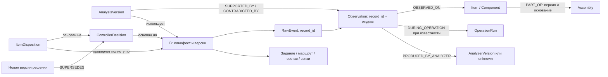

# Модель оснований решения: «тогда» и «сейчас»

Дата: 25 сентября 2026. Роль №1. **Статус: спроектировано как предложение для взаимного review; не реализовано.** Основание — [ADR-001](../adr/001-core-architecture.md), [brief](../architecture-design-brief.md) и [contracts.md](../contracts.md) v0.2.

Это семантическая модель, не новая версия OpenAPI. Названия B1/A1/D1 ниже — обозначения примера, не готовые транспортные поля. Метаданные и расширение транзакций нужно согласовать обеим ролям до изменения схем и потребителей.

## 1. Четыре разных объекта

| Объект | Что означает | Кто создаёт / что изменяется |
| --- | --- | --- |
| Свидетельство | Ядро приняло сообщение определённого источника с определённым содержимым | Аутентифицированный источник; исходник неизменяем. Это не доказательство физической истинности сообщения |
| Представление истории и версия анализа | Интерпретация известных свидетельств с конкретными правилами, связями и справочниками | Обработчик; новое знание создаёт новую версию, прежняя остаётся |
| Решение по несоответствию | Человек подтвердил, отклонил или запросил проверку; отдельно указал степень установленности причины | Авторизованный контролёр, сервер фиксирует автора/время; уточнение — новая запись |
| Решение по изделию | `pending`, `released`, `rework`, `rejected` | Отдельная команда контролёра; наличие признаков не является решением о выпуске |

Исходное `no_defect_signs` при `poor/unknown` сохраняется буквально; эффективное значение — `not_assessable`. Гипотезы `incoming/equipment/operator` не являются установленной причиной. Поле `review_required` относится к текущей оценке применимости решения, а не к переписыванию старой записи решения.

## 2. Идентичность, время и версии

- **Доставка:** уникальный `(source_id, event_id)` плюс сравнение канонического JSON. Совпадение возвращает прежнюю квитанцию; другое тело — конфликт. Два разных источника могут иметь одинаковый `event_id`.
- **Ссылка на исходник:** предпочтительно серверный `record_id` с доступным отображением в `(source_id, event_id)`; альтернатива — составной ключ. Для внешней совместимости выбор согласуется с ролью №2. Один `event_id` без источника недостаточен.
- **Элемент наблюдения:** серверный `observation_id` связан с `record_id` и индексом в исходном `defects`. Массив исходника не переставляется; транспортный повтор не создаёт новые элементы.
- **Кандидат дефекта:** `(source_id, item_id, component_id, region_id, defect_ref)` по v0.2. Неизвестные компонент/область не wildcard. Без стабильного ref или при разных источниках автоматического объединения нет; решение о связывании сохраняется отдельно.
- **Время:** `occurred_at` — утверждение источника; `received_at` — серверная отметка приёма. Время решения — серверное. При равных/ненадёжных временах `(source_id, event_id)` обеспечивает стабильную сортировку, но не причинный порядок.
- **Версии:** отдельно идентифицируются конверт, обработчик истории, анализ/правила, внешний анализатор, задание, маршрут, состав, связи и решение. Номер ревизии истории не заменяет весь этот набор.

`received_at <= время решения` тоже недостаточно для восстановления видимого состояния: сообщение могло ещё не закоммититься, UI мог открыть старую ревизию, справочник мог смениться. Два времени помогают объяснять задержку; **точный сохранённый набор входов определяет вычисление**.

Исправление ошибочного исходного сообщения — отдельная запись со ссылкой на исправляемое основание; сырой payload и оба исходных времени не обновляются. Разрешение ненадёжной связи — отдельное утверждение с автором/источником и основанием, а не подмена item_id в raw. Тип сообщения и полномочия на такие исправления ещё нужно согласовать; v0.2 не получает их автоматически из этого документа.

## 3. Предлагаемый минимальный набор оснований

Набор B — неизменяемая сущность, на которую ссылаются анализ и решение. Он может хранить ссылки на другие неизменяемые наборы без копирования всех данных. Одного хеша без списка входов недостаточно. Снимок проекции без версии правил тоже недостаточен.

| Состав B | Зачем нужен | Что делать при неизвестности |
| --- | --- | --- |
| Идентификатор, цель и ревизия контекста | Различить изделие/карточку и конкретный просмотренный контекст | Команда со старой ревизией не принимается как новая |
| Манифест входов | Все факты области расчёта и их ID; для каждого роль: использован, противоречащий, исключён с причиной | Ненадёжные привязки и пропуски учитываются явно; не скрываются фильтром «только хорошие» |
| Связанные решения, когда они используются | Например, disposition опирается на рассмотрение дефекта и его конкретную версию | Не ссылаться на изменяемое «последнее решение» |
| Версии задания, маршрута/контроля, проектного и фактического состава, ID-маппинга | Не читать `latest` при восстановлении прошлого | Ссылка unresolved сохраняется как неизвестность; выпуск невозможен при неизвестных обязательных проверках |
| Версия обработчика и правила/параметры анализа | Отделить новое знание от нового алгоритма | Отсутствие старого исполняемого артефакта означает «снимок доступен, повтор расчёта недоступен» |
| Версии наблюдений, анализаторов и связей | Проследить происхождение и меняющуюся привязку | Версия анализатора может быть неизвестна по v0.2; возможность использовать такой контроль определяет согласованное правило метода |
| Снимок полноты, противоречий и неизвестности | Доказать, чего контролёр не знал, а не только что использовал | Неизвестный маршрут не превращается в пустой список выполненных проверок |
| Сохранённый результат анализа и происхождение материалов | Показать вывод, ограничения, ссылки и доступность медиа на момент анализа | Нет фото — прямо указать; недоступный материал не объявлять просмотренным |
| Происхождение самого набора | Кто/какой процесс, когда и для какой ревизии собрал B; ссылка на предыдущую версию | Время не подменяет идентичность содержимого |

Само решение сохраняет автора, серверное время, действие, причину, цель, ссылку на B и предыдущую запись при пересмотре. Автор не берётся из поля входного source event. Идемпотентность команды решения сохраняет правила v0.2.

**Почему манифест содержит не только «поддерживающие» факты:** иначе отрицательное наблюдение, которое противоречило гипотезе, исчезнет из объяснения. Для известной области нужно сохранять охват отбора и классификацию входов. Это воспроизводимость доступных ядру сведений, не гарантия, что источник доставил вообще всё.

По [W3C PROV-DM, S5](../research/architecture-sources.md) отдельные версии можно описывать как entities, анализ — activity с used/generated, автора — agent, связь версий — revision. Наш B — предметный набор оснований с provenance; соответствие конкретному формату PROV не заявлено и не требуется для этого среза.

## 4. Связи и область адресного пересмотра

Детальная [мета-модель и алгоритм адресного пересмотра](evidence-graph.md) уточняют этот раздел: исторический состав, области ожидания новых входов, объяснение пути, неизвестный охват и проектная сериализация межиздельных изменений. [Независимые ожидаемые результаты](impact-review-cases.md) включают наблюдение до установки, перестановку компонента и гонки. Статус — предложение для review, без реализации.



Это семантика, которую предлагаем хранить типизированными SQL-связями. Не все стрелки автоматически являются фактами:

| Связь | Класс и происхождение | Ограничение |
| --- | --- | --- |
| Компонент → фактическая сборка | Заявление производственного источника/решение о привязке с версией | Проектный состав CAD не доказывает фактическую установку |
| Наблюдение → операция/объект | Заявлено источником при надёжной идентификации; иначе вычисленная кандидатная связь | Интервал времени без ID не делает связь достоверной |
| BEFORE / AFTER | Вычислено конкретными правилами из сопоставимых наблюдений | Сомнительные часы и разные области не задают порядок причины |
| SUPPORTED_BY / CONTRADICTED_BY | Интерпретация основания в конкретной версии анализа | Поддержка гипотезы не равна установлению физической причины |
| Решение → B; SUPERSEDES | Факт принятой авторизованной команды | Новый анализ сам по себе не supersedes решение человека |

Поиск влияния выполняется в два шага:

1. **Явные зависимости:** изменения связи/версии находят использовавшие её наборы B и решения. Исторические связи сохраняются, чтобы перенос компонента не скрыл старые затронутые сборки.
2. **Зависимости от области:** новый факт сопоставляется с изделием, компонентом, операцией/контрольной точкой и областью решения, даже если его ID отсутствует в старом B. Сохраняются и ожидания ещё отсутствующего обязательного контроля. В простом пилоте консервативная область — всё надёжно идентифицированное изделие; сужение до компонента требует подтверждённых правил.

Затем пересчитываются затронутые анализы; изменение оснований, противоречий или полноты создаёт текущий `review_required`. Причина пересмотра показывает добавленные/изменённые зависимости. Review по новой ревизии не создаётся повторно при транспортном дубле.

**Неизвестная привязка:** событие остаётся `unresolved`; создаётся задача разрешения связи. Известный возможный круг изделий получает признак неполноты оценки. Если круг неизвестен, нужна задача по участку/партии и регламент ограничения выпуска с ОТК — отсутствие найденных рёбер нельзя трактовать как отсутствие влияния. Конкретную область и полномочия должен подтвердить пилот роли №2.

## 5. Синтетический пример `assembly-001`

Продолжение [first-slice.md](../first-slice.md) и brief. Всё ниже — **синтетическая ручная трасса, ожидаемое поведение, не выполненный end-to-end тест**. Дата 25.09.2026, времена UTC. Медиа отсутствуют.

Для примера предполагаем: задание `order-001@1`, маршрут `route-bracket@1`, состав `assembly-001@1` с `bracket-001`/`insert-001` импортированы и подтверждены; ID-маппинг M1 известен. Обязательные точки — входная, после механической обработки, финальная. Стабильный `mark-001` принадлежит одному `vision-emulator-1`; `component_id=insert-001`, `region_id=face-A`, все контрольные события относятся к `item_id=assembly-001`. Правило связывания — предположение источника, которое роль №2 должна подтвердить на физическом маршруте.

### 5.1. Входы и момент доступности

Короткие R-ID обозначают разные серверные записи. Приём условно завершается commit в указанную секунду; это упрощение примера, а не гарантия точности серверного timestamp.

| Ссылка | Произошло | Доступно ядру | Содержимое |
| --- | --- | --- | --- |
| W1/M1 | 10:00:00 | 10:00:01 | Импорт задания/маршрута/состава и маппинг версии 1; отдельные версионированные записи контекста |
| R1 | 10:01:00 | 10:01:01 | Поступление изделия, ссылки на задание и компоненты |
| R2 | 10:02:00 | 10:02:01 | Входной `no_defect_signs`, good |
| R3 | 10:03:00 | 10:03:01 | Начало `run-machining-001` |
| R4 | 10:05:00 | 10:05:01 | Завершение `run-machining-001` |
| R5 | 10:06:00 | 10:06:01 | После обработки `no_defect_signs`, good |
| R6 | 10:07:00 | 10:07:01 | Начало `run-assembly-001` |
| R7 | 10:08:00 | 10:08:01 | Отклонение `machine-02` во время сборки |
| R8 | 10:09:00 | 10:09:01 | Завершение `run-assembly-001` |
| R9 | 10:10:00 | 10:10:01 | Финальный `defect_signs`, mark-001, good, analyzer emulator-1 |
| Повтор R9 | 10:10:00 | 10:10:05 | Тот же ключ/тело: квитанция R9, новой записи нет |
| R10 | 10:11:00 | 10:11:01 | Новый ID, тот же mark-001, good, analyzer emulator-1 |
| D1 | — | 10:12:00 | Контролёр подтверждает дефект по B1; причина unresolved |
| P1 | — | 10:12:30 | Отдельное решение rework по изделию, набор BP1 включает B1 и D1 |
| R11 | **10:02:30** | **10:20:00** | Поздний входной `defect_signs`, тот же mark-001, good, analyzer emulator-1 |

Все времена/привязки в основной трассе считаются надёжными. R2/R5 и R11 не исправляют друг друга: это разные наблюдения. Если метод, область или точность времени не сопоставимы, вывод о наличии признака «до операции» ослабляется до явной неопределённости.

### 5.2. Что было известно в 10:12

- B1 фиксирует **R1–R10**, импорт W1/M1, версии состава/маршрута, правила анализа Q1 и обработки истории T1, версии анализаторов из наблюдений, состояния контроля и ограничений. R11 в нём нет.
- A1 показывает два финальных наблюдения одного кандидата; R7 — обстоятельство для гипотезы оборудования. Альтернативы: более ранний недетектированный дефект, перемещение/сборка, ограничение метода. Причина не установлена.
- D1 подтверждает существование одного дефекта, `cause_status=unresolved`, категория unknown; основание B1, автор controller-demo. Решение P1 направляет на доработку и дополнительно ссылается на D1. Подтверждение дефекта не создаёт подтверждённой ошибки оператора.
- Каждая завершённая операция имеет calculated `station_elapsed=120 s`. Активное время неизвестно. Переданные измерения, если появятся, хранятся рядом с собственными происхождением и основанием, не заменяют calculated.
- Оценимые наблюдения обязательных точек есть, но финальная точка содержит дефект: полнота выполнения контроля не означает успешное прохождение. Выпуск запрещён, rework допустим. Медиа отсутствуют, вывод основан на структурированных сообщениях.

BP1 — отдельный набор для P1: он ссылается на неизменяемый B1 и уже принятое D1, фиксирует актуальную ревизию контекста изделия после D1. Это не повторное использование устаревшей expected_revision команды подтверждения дефекта. Аналогично BP2 для нового disposition включает B2 и D2. Общие неизменяемые входы можно разделять между наборами, а цель и ревизия каждой команды остаются своими.

### 5.3. Что изменилось в 10:20

| Объект | «Тогда», A1/B1 | «Сейчас», A2/B2 |
| --- | --- | --- |
| Манифест | R1–R10 + W1/M1 | R1–R11 + те же версии контекста |
| Порядок истории | R2 → R3 → … → R10 | R2 → **R11** → R3 → … → R10; время приёма R11 видно отдельно |
| Наблюдения признака | R9, R10 | R9, R10, R11 — один кандидат по полному ключу |
| Анализ | Возможна связь со сборкой/станком, есть альтернативы | Входное происхождение — новая поддержанная гипотеза; R2/R5 остаются несогласующимися наблюдениями, их нельзя удалить |
| Человеческое решение | D1 confirm, причина unresolved; P1 rework | D1/P1 неизменны; текущая применимость требует review |
| Полнота | Все 3 точки оценимы, финальная с дефектом | Те же точки присутствуют; входная область требует разбора противоречий/разницы метода |
| Показатели на одной когорте | 1 проверенное изделие, 1 подтверждённый дефект, 1 изделие с дефектом, 0 ошибок оператора | Те же числа; отдельно видно pending review. Причина автоматически не становится established |
| Повторные операции | 0 | 0: решение rework ещё не является выполненной повторной операцией |
| Внешний результат | V1 по P1, message MSG1 | V2, новый message MSG2 со ссылкой на V1, review_required=true |

R11 поддерживает наличие признака **до механической обработки и сборки**, а не доказывает брак поставщика или конкретный момент возникновения. Где/когда признак обнаружен, где он физически возник и какая причина подтверждена — разные вопросы. Автоматического обвинения `operator-01`/`operator-02` нет.

При повторном просмотре контролёр создаёт D2 с B2: может подтвердить прежнее действие, оставить причину unresolved и назначить дополнительную проверку. Если это меняет основание disposition, создаётся P2, даже если его значение опять rework. D1/B1/P1 остаются доступными. Review снимается только в пределах явно рассмотренных зависимостей и актуальной ревизии; новая параллельная R12 требует нового просмотра.

### 5.4. Схема позднего события

```mermaid
sequenceDiagram
  participant E as Источник
  participant C as Ядро
  participant DB as PostgreSQL
  participant H as Контролёр
  participant O as Доставка outbox
  participant ERP as ERP-эмулятор
  Note over C,DB: D1/B1 и P1 уже сохранены; V1 доставлен
  E->>C: R11: occurred 10:02:30, доставлено 10:20
  C->>DB: BEGIN; ключ события и затронутое изделие
  C->>DB: Проверка дубля, исходников и версий контекста
  C->>C: Replay области: A2/B2; сравнение зависимостей
  C->>DB: Raw R11 + проекции + A2/B2 + review + outbox V2
  C->>DB: COMMIT
  C-->>E: accepted после commit
  Note over C,DB: D1/B1/P1 не переписываются
  O->>DB: Получить V2 для доставки
  O->>ERP: MSG2, V2, review_required=true
  ERP-->>O: ACK MSG2
  O->>DB: Зафиксировать ACK
  H->>C: Открыть сравнение B1/B2
  C-->>H: R11 добавлен, ограничения и причины review
  H->>C: Новое решение, актуальная revision, idempotency key
  C->>DB: Проверить контекст; сохранить D2/B2 атомарно
  Note over H,DB: При устаревшем контексте новая команда отклоняется
```

Схема — предложение целевого пути. Реализованный replay сейчас перестраивает только историю и операции; A2/B2, решения и outbox в коде отсутствуют. Ошибка до commit откатывает всю команду; потеря ответа после commit закрывается повтором с прежним ключом. Повтор R11 не создаёт A3/B3 или MSG3.

## 6. Полнота контроля и разрешение выпуска

Предлагаем хранить оценку каждой обязательной точки отдельно от общего статуса изделия: применимая версия требования, цель/область и экземпляр операции, подтверждающие наблюдения, оценимость, результат и ограничения. Слова «пропущено», «противоречие», «неизвестен маршрут» ниже — категории объяснения, не новые enum v0.2.

| Ситуация | Интерпретация | Можно ли released? |
| --- | --- | --- |
| Обязательная точка известна, наблюдения нет | Контроль не подтверждён | Нет |
| no_defect_signs, poor/unknown | Эффективно not_assessable | Нет |
| good, no_defect_signs, корректная область/операция | Признаков данным методом не найдено | Только вместе с остальными проверками и отдельным решением |
| good, defect_signs | Признак для рассмотрения; оценимый контроль не означает годность | Нет при открытом/подтверждённом несоответствии |
| Противоречащие сопоставимые наблюдения | Сохранить оба и запросить разбор, а не «последний победил» | Нет до разрешения неопределённости |
| Неизвестны маршрут/состав/применимость точки | Неизвестен знаменатель полноты | Нет; не считать 0 из 0 выполненным контролем |
| Нужное доказательство было доступно, теперь потеряно | Историческая ссылка остаётся, текущая проверяемость ухудшилась | Требуется оценка влияния и review по регламенту |

Полнота — минимум два вопроса: «все ли применимые точки оценимы?» и «позволяют ли результаты/решения выпуск?». Отрицательный ответ на любой блокирует released. При доработке новые операции имеют новые ID; старый контроль не покрывает новый цикл автоматически. Правило переноса или повторения конкретной проверки определяется версией маршрута и технологом.

Изменение маршрута не применяется задним числом молча: новая версия должна иметь владельца и область применимости к уже изготовленным изделиям. Исторический B хранит прежнюю версию; оценка нового требования — новый анализ. Неизвестная применимость остаётся открытым вопросом, а не произвольным выбором latest.

## 7. Согласованность решения при конкурентном приёме

Проектное предложение: контекст карточки/изделия имеет ревизию, учитывающую факты, связи и выбранные версии справочников. Анализ, его B и индекс зависимостей согласованы в одной транзакции. При принятии решения фиксируется именно показанный контекст и под той же сериализацией проверяется его актуальность.

1. Проверить аутентификацию и повтор команды. Успешный прежний повтор вернуть до проверки `expected_revision`.
2. Заблокировать затронутое изделие и согласованный контекст; для нескольких изделий — стабильный порядок ID. Проверить, что импорт/активация применимых справочников не изменили зависимости.
3. Сопоставить `expected_revision` с текущим контекстом цели. Устарела — `409 stale_revision`, перечитать карточку.
4. Сохранить неизменяемые решение и ссылку на B, обновить проекцию и outbox одной транзакцией.

Это не обещание, что UI отображал каждый байт или контролёр прочёл все сведения: B фиксирует предоставленный контекст и основание принятой команды. Правило изменения ревизии при обновлении общего маршрута/маппинга и соответствующие блокировки требуют согласования; текущий per-item lock сам по себе не закрывает гонку с импортом справочника.

Если позднее событие коммитится после D1, D1 законно сохраняется и затем требует review. Если R11 раньше D1, старая команда D1 не должна проскочить только потому, что строка статуса дефекта не изменилась. Это главный конкурентный контрпример для проверки.

## 8. Проверка модели после review

Ожидаемые результаты для будущего эксперимента приведены отдельно от входной трассы. Это план приёмки, не новые успешно пройденные тесты.

| Сценарий | Наблюдаемый результат | Инвариант ADR |
| --- | --- | --- |
| Основная трасса до D1/P1 | B1 содержит R1–R10; один дефект, одна дефектная сборка, 0 ошибок, два интервала по 120 s | I1–I3 |
| R11 после решения | B1 и D1 неизменны; B2 содержит R11; review и V2; число дефектов 1 | I1, I2 |
| Повтор R9 или R11 после replay | Исходная квитанция, без новой версии анализа/результата | I2 |
| Одинаковый event_id у двух источников | Разные raw; ссылку нельзя разрешать по одному event_id | I2 |
| Тот же ключ, изменённое тело | Конфликт, исходник и проекция не затронуты | I1, I2 |
| R11 с uncertain identity/time | Нет уверенного «до операции»; связь/порядок unresolved, проверка влияния открыта | I3 |
| Нет R5 или poor вместо good | Конкретная обязательная точка не покрыта; выпуск недопустим | I3 |
| Нет W1 или неизвестна версия маршрута | Знаменатель полноты неизвестен; выпуск недопустим | I3 |
| Новая версия правил Q2 | Новый анализ, старый B1 остаётся на Q1; повтор старого расчёта не использует Q2 | I1 |
| Команда решения одновременно с R11 | Либо stale_revision, либо сохранённое решение и последующий review; не потерянное изменение | I1 |
| Независимое изделие assembly-002 | При подтверждённом отсутствии общих зависимостей его анализ не меняется | I1 |
| Неизвестна принадлежность компонента | Не заявляется полный узкий охват; задача разрешения и консервативный review | I3 |
| Сбой перед commit / потеря ACK после отправки | Нет частичной команды / повтор прежнего message_id, без повторного применения ERP | I1, I2 |
| V2 приходит раньше V1 | ERP хранит обе версии, но не откатывает текущий результат на V1 | I1 |
| Потерян старый ключ/исполняемый артефакт | Явно ограничена возможность проверки/повтора; нет фальшивого «воспроизведено» | I1 |

Существующие 100 тестов `708e2de` проверяют журнал и историю, включая часть повторов/поздних границ/откатов. Они **не подтверждают** D1/B1, дефекты, completeness, outbox или перечисленные сквозные сценарии. Команды и ограничения — в [backend/README.md](../../backend/README.md).

## 9. Передача роли №2

Полученное через участника сообщение роли №2 подтверждает контрактные замечания и сообщает о 17 из 32 положительных событий, не проходящих текущую OpenAPI из-за nullable-связей. **Это результат проверки роли №2, здесь повторно не запускался.** База сравнения — `codex/role-2-mvp@b169089`. Новый backend опубликован в `708e2de`, merge архитектурной базы — `345cba7`.

| Тема | Предложение роли №1 / что требуется от №2 | Статус |
| --- | --- | --- |
| Обязательность, nullable, типовые условия payload | Различать отсутствующее поле и допустимое null; сохранить v0.2 для неизвестных связей; отдельно проверить allOf/generated и before/after/defects/assembly | №2 готовит варианты; контракт пока не изменён |
| Неизвестный тип компонента | Не выводить тип из ID; явная неизвестность до версии справочника | №2 предлагает модель чтения и владельца |
| Модель задания | Сохранить тип изделия, route ID/revision, обязательные точки, версии проектного/фактического состава и применимость | №2 определяет владельцев ERP/MES/PLM, №1 рецензирует связь с B |
| Длительности | Несколько измерений с kind/unit/origin и ссылками на основания; calculated station_elapsed отдельно от reported active_processing | Совместное решение по DTO; данные среза уже раздельны |
| Идентичность оснований | Предпочтение record_id с отображением в составной ключ, observation_id для элемента | Совместный выбор публичных ссылок и проверки их доступности |
| Публичные ошибки | Внутренний event_conflict отображать на стабильный публичный код; выбрать conflict либо event_conflict один раз для схемы/expected/UI | Совместное решение, публичный код здесь не утверждён |
| Ревизия и B | Ревизия включает зависимости контекста; манифест, версии, неизвестность и снимок результата | Новое проектное предложение №1; нужна рецензия до изменения контракта |
| Физические границы | Доказать стабильность mark-001, сопоставимость областей/часов; поведение при offline и неизвестном круге изделий | №2 включает в enterprise-pilot |

Просьба к роли №2: пройти таблицу «тогда/сейчас», оспорить производственные предположения и ответить на пять вопросов:

1. Кто владеет обязательными точками и определяет применимость новой версии маршрута к уже начатому изделию?
2. Как один источник обеспечивает стабильный defect_ref между входным и финальным контролем; что делать при разных камерах/источниках?
3. Как ОТК действует при позднем факте с неизвестным составом/кругом изделий и кто вправе ограничить выпуск?
4. Как получатель обрабатывает V2 раньше V1, потерю ACK и review уже переданного результата?
5. Какие сроки хранения исходников, медиа, версий анализа и ключей, RPO/RTO и предел времени review нужны пилоту?

**Следующий результат №1:** согласование [алгоритма адресного пересмотра](evidence-graph.md), рецензия enterprise-pilot по полноте данных/гарантиям edge и уточнение ADR по ответам. **Следующий результат №2:** enterprise-pilot и review этой модели, включая владельца фактического состава и действия при неизвестном круге изделий. Регенерация, UI и новый backend-эксперимент выбираются после согласования; документационная поставка ещё не означает общий freeze.
