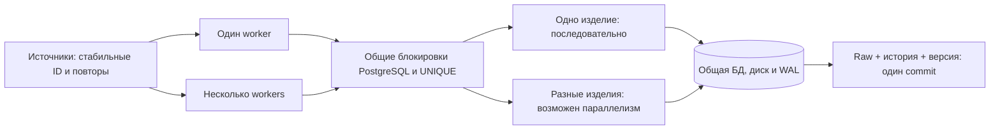

# Цена истории и масштабирование ядра

Дата: 25 сентября 2026. Роль №1. **Статус: архитектурное предложение; выполнен ограниченный измерительный эксперимент существующего reducer.** Предметный backend и контракт v0.2 не изменены. Полное нагрузочное испытание, горизонтальное масштабирование и оптимизации ниже не реализованы. Основания — [ADR-001](../adr/001-core-architecture.md), [Evidence Graph](evidence-graph.md), постановка §3.1 и §6.1.

## 1. Производственная задача и область эксперимента

Для функции «что знали тогда / что знаем сейчас» нужно сохранять версии. Для адресного пересмотра нужно пересчитывать затронутые изделия. Вопрос: какова цена этих функций и когда простое ядро перестанет справляться?

Сравнены три способа получить ответ:

| Вариант | Что узнаём | Ограничение |
| --- | --- | --- |
| Анализ кода и сложности | Где повторяются обходы, чтения и снимки | Не даёт фактического времени |
| **Микроизмерение существующего reducer и сериализации** | Цена разных форм истории без сети/БД; воспроизводимый рост снимков | Не измеряет приём, SQL, шифрование, ожидание блокировок и отказоустойчивость |
| Полный нагрузочный стенд приёма | Пропускная способность, backlog и tail latency всей системы | API/решения/outbox ещё не интегрированы; ранний стенд не измерит целевой путь |

Выбран второй вариант вместе с анализом кода как узкий исследовательский эксперимент. Скрипт [measure_replay.py](../../backend/scripts/measure_replay.py) строит синтетические входы только в памяти и вызывает существующие `trace_fact()` / `rebuild_history()`. Он не меняет способ хранения или обработки событий. Новые продуктовые функции по-прежнему требуют review/freeze.

## 2. Что стоит работающая транзакция

По коду `backend/app/adapters/traceability.py`:

1. Блокировка ключа события; при повторе — прежняя запись и проверка её подлинности, без нового replay.
2. Для нового надёжно идентифицированного события — per-item advisory lock в PostgreSQL.
3. Выборка **всех** исходников изделия, расшифрование, проверка и предметный разбор каждого.
4. Полный `rebuild_history()` с новым событием.
5. `asdict` → JSON → Python-структура снимка; сравнение с текущим снимком.
6. Запись текущего снимка и полной append-only версии при изменении. Для каждого события истории — отдельный SELECT состояния и при необходимости UPDATE.
7. Commit, затем квитанция. Внешней отправки в этой транзакции сейчас нет.

При n событиях, m операциях и среднем размере защищённого входа b:

- Выборка/проверка входов — O(n × b) обработки данных, память всех фактов порядка O(n × b).
- Сортировка — O(n log n) в общем случае. Предметная сборка в основном линейна, но проверка цепочек `previous_operation_run_id` заново обходит предков для каждой операции: до O(m²).
- Копирование/сериализация полного снимка — O(s), где s — его размер; одновременно существуют несколько представлений, поэтому JSON-байты не равны пику RAM.
- В `_save()` число SQL-запросов проверки состояния растёт как O(n). Локальный CPU-замер не включает эти round trips.
- Если после каждого нового факта пересобирать всю историю, суммарно за N событий получаем до O(N² log N) работы сортировки и до O(N³) в неблагоприятной длинной цепочке операций. Это оценка верхнего порядка, не измеренная задержка предприятия.

Таким образом, количество HTTP-процессов само по себе не устраняет дорогой replay и запись снимков. Особенно важно различать **одно горячее изделие** и **много независимых изделий**.

## 3. Воспроизводимый локальный замер

Из `backend/`, после установки окружения по [backend/README.md](../../backend/README.md):

```powershell
.\.venv\Scripts\python.exe scripts/measure_replay.py --operations 50 250 1000 --repeats 7 --growth-operations 20 40 80
```

Полный зафиксированный результат: [replay-measurements.json](replay-measurements.json). Runtime-база `a1e8d87`, `traceability-v1`, Python 3.11.9, Windows build 26200, AMD64 Family 25 Model 80, 12 логических CPU. Процесс однопоточный; 12 CPU не означает использование всех ядер.

После восстановления прерванной сессии выполнен повторный прогон на той же runtime-базе; полный stdout автоматически сохранён в [replay-measurements-repeat.json](replay-measurements-repeat.json). Команда:

```powershell
.\.venv\Scripts\python.exe scripts/measure_replay.py --operations 50 250 1000 --repeats 7 --growth-operations 20 40 80 --output ../docs/architecture/replay-measurements-repeat.json
```

Для следующего запуска с сохранением выбрать **новое имя**: `--output` создаёт UTF-8 JSON и отказывается перезаписывать существующий файл. Каталог должен существовать. Без параметра результат выводится только в stdout. В повторном отчёте время окончания добавляется автоматически; прежний отчёт сохранён как исходный замер.

Методика: одно синтетическое изделие, поступление + по два события на операцию; все операции по 120 секунд. Два варианта — без связей повторной обработки и одна длинная цепочка повторов. Перед измерением проверяются число событий/операций, длительности, число rework-ссылок и равенство результата при обратном и перемешанном порядке. Время генерации/валидации входов и проверок исключено; один предварительный расчёт/кодирование прогревает пути. Семь повторов, стабильное перемешивание с seed 20260925, обычный GC. Вывод — медиана, максимум и все образцы; p95/SLA из семи повторов не заявляются. Рабочая машина не изолирована от фоновой нагрузки.

| Операции / события | Обычный replay, медиана мс | Цепочка повторов, медиана мс | Подготовка JSON обычного снимка, медиана мс | Обычный снимок, байт |
| --- | ---: | ---: | ---: | ---: |
| 50 / 101 | 1,232 | 1,273 | 7,988 | 83 421 |
| 250 / 501 | 5,706 | 8,929 | 36,319 | 413 821 |
| 1 000 / 2 001 | 25,468 | 78,297 | 150,649 | 1 652 821 |

**Наблюдение:** на 1 000 операций длинная цепочка увеличила медиану reducer примерно в 3,1 раза. Подготовка JSON обычного снимка заняла примерно в 5,9 раза больше времени, чем сам reducer. Поэтому приоритет проверки — представление снимка и запросы состояния, а не немедленное добавление брокера или графовой БД.

Повторный сохранённый прогон: для 50/250/1 000 операций медианы обычного replay — **0,987 / 5,152 / 22,476 мс**, цепочки — **1,136 / 8,404 / 70,870 мс**, JSON обычного снимка — **6,945 / 33,727 / 141,657 мс**. Все размеры шести итоговых снимков и трёх наборов версий совпали с первым отчётом. На 1 000 операций отношения составили около **3,2×** и **6,3×**: вывод об источниках затрат повторился. Разница времени между прогонами — вариация локального измерения; оптимизация runtime между ними не выполнялась.

Измеряется `asdict` + JSON encoding + UTF-8. Адаптер дополнительно делает JSON decoding и передаёт структуры драйверу/БД; шифрование, SQL, commit и блокировки исключены. Сумма медиан этапов не является измеренной медианой приёма. По этой таблице нельзя обещать события/с, время UI или промышленную вместимость. Синтетические 1 000 повторов — стрессовая форма данных, не утверждение о типичном маршруте.

### Цена хранения каждой полной версии

Скрипт отдельно считает реальные JSON-байты снимка после **каждого** префикса потока обычных операций. На каждом шаге история меняется. Это расчёт представлений в памяти, а не запись в PostgreSQL.

| События / версии | Последний снимок, байт | Сумма всех версий, байт | Отношение к последнему |
| --- | ---: | ---: | ---: |
| 41 | 33 861 | 716 243 | 21,15× |
| 81 | 66 901 | 2 753 263 | 41,15× |
| 161 | 132 981 | 10 792 103 | 81,16× |

При примерно линейном росте размера снимка сохранение всех префиксов даёт квадратичный рост суммы. Последнее значение — около 10,3 MiB версий при последнем снимке около 130 KiB. Raw, текущая проекция, B, индексы, WAL и backups здесь не учтены; JSONB/TOAST могут изменить физический размер. Полное хранилище измеряется отдельно через PostgreSQL, а не умножением этих чисел на обещанный парк изделий.

## 4. Выбор следующей оптимизации

| Вариант | Польза | Цена / отказ | Проверка перед принятием |
| --- | --- | --- | --- |
| **Полный replay как эталон + удешевление сериализации и пакетная работа с состояниями** | Сохраняет простую семантику; убирает повторяемые расходы | Нужно доказать эквивалентность представления, SQL-атомарность и корректный no-op | Сравнить снимки и состояния на поздних, конфликтных и uncertain-входах; измерить число запросов и commit-time |
| Инкрементальные проекции и контрольные снимки | Уменьшает обычную работу и хранение | Позднее событие/новые связи могут потребовать длинного пересчёта; сложнее поддержка правил | Полный reducer — независимый эталон; новые версии B/решений сохраняются; проверить восстановление |
| Асинхронный replay после commit raw | Сокращает время приёма | Появляется отставание; решение/выпуск может опереться на старую проекцию | Отдельный ADR accepted, durable-job, лаг, проверка актуальности решения и падение worker |

Предварительно выбирать первый вариант после измерения транзакции в БД; второй — если версии/длинные истории действительно упираются в бюджет. Третий не включать как скрытую оптимизацию. Реализовывать сразу все три не требуется.

Для проверки цепочек можно рассмотреть линейный обход с запоминанием состояния узлов, но только с сохранением смысла: цикл помечает его участников; ведущая в цикл цепочка не становится автоматически участником цикла. Тесты должны включать самоссылку, длинный цикл, хвост, отсутствующего предка и позднее появление предка. Код reducer в этой поставке не менялся.

**Версии решений:** нельзя экономить удалением B/анализа, на которые ссылается принятое решение. Общие неизменяемые фрагменты можно разделять; контрольные снимки ускоряют вычисление, но не подменяют список оснований и старую версию правил. Чтение исторического результата и полный повтор расчёта — отдельные гарантии.

## 5. Один и несколько обработчиков



Это схема реализованной per-item модели, не отчёт о нескольких запущенных процессах. Восемь потоков существующих тестов проверяют конкуренцию ключей/истории, но не горизонтальный рост раздельных workers.

- Единственный авторитетный state — PostgreSQL; уникальность `(source_id, event_id)` и advisory locks общие для процессов. Локальные mutex/cache не заменяют их.
- Доставка одного источника может идти не по порядку. `occurred_at` определяет отображение, при равенстве — source/event ID, а не доказательство причины. Порядок commit и физическое время события различаются.
- Горячее изделие упирается в время под своим lock. Несколько процессов могут ускорить независимые изделия только пока хватает CPU/диска/соединений БД. Connection pool умножается на число процессов; бесконтрольное увеличение pool усугубляет ожидания.
- Для предложенного межиздельного [impact-v1](evidence-graph.md) первый эталон использует **общий guard всех writers**. Тогда независимые изделия тоже сериализуются. Замеры reducer не обосновывают пропускную способность этого guard; смешивать новый и старый протокол writer запрещено.
- Следующий вариант параллелизма межиздельных изменений — согласованный барьер топологии и упорядоченные блокировки либо SERIALIZABLE с повтором транзакций. Выбор требует отдельной проверки новых/исчезающих зависимостей, общих маршрутов и команд решения.

Оценка для последовательной области: при средней занятости блокировки T секунд долгосрочная скорость обслуживания не выше примерно 1/T команд/с без учёта прочих ограничений. Это модель очереди, не SLA; время ожидания резко растёт при приближении поступления к обслуживанию. Измерять нужно commit-path, а не только reducer.

### Отказовый сценарий

Worker A держит lock изделия, вычислил историю и падает до commit. PostgreSQL откатывает транзакцию и освобождает lock после завершения/обнаружения разрыва соединения. Источник повторяет прежний ключ; worker B сохраняет одну согласованную версию. Если commit уже завершён, а ответ потерян — повтор читает прежнюю квитанцию. Текущие тесты доказывают rollback при исключении и конкурентные доставки; принудительное завершение отдельного процесса и задержку обнаружения разрыва ещё нужно проверить.

При будущем outbox падение после внешнего применения, но до сохранения ACK, ведёт к повтору того же message_id. Это обязанность адаптера/получателя; добавление workers её не отменяет. Время ожидания lock/statement timeout и политика повторов должны быть конфигурацией, а не молчаливой потерей события.

## 6. Рост, настройки и последующие измерения

| Направление | Что меняется | Когда оправдано / что измерять |
| --- | --- | --- |
| Вертикальный рост | CPU, RAM, быстрый диск; настройки PostgreSQL и pool под бюджет соединений | CPU/память, IO/WAL, объём raw/версий, длительность запросов; не снимает квадратичный рост |
| Несколько workers | Число процессов, pool на процесс, routing и ограничения конкуренции | Независимые изделия, число активных соединений, ожидание locks, одинаковые результаты при 1/2/4 workers |
| Брокер | Transport adapter, durable consumers, partition key, retry/dead-letter, offsets после commit | Backlog и независимые потребители; доставка at-least-once, повтор после commit до offset; межиздельный graph не укладывается автоматически в item partition |
| OpenTelemetry | Инструментирование ingestion/replay/SQL/outbox, локальный collector, sampling/retention | Длительность стадий и locks, queue age, accepted/duplicate/conflict, число посещённых целей, размер версий; raw/ключи не экспортируются |

Порты `EventJournal`, `EventProtector`, `EventCodec` уже отделяют сценарий от адаптеров. Новый брокер вызывает тот же сценарий приёма с проверенной идентичностью источника. Trace ID не заменяет record_id. При отсутствующем collector обработка не должна зависать; метрики не включают item_id/event_id как высококардинальные labels.

Настройки workers/pool/timeouts/batch и лимита обхода ниже — **предлагаемые категории конфигурации**, не существующие env-переменные. Для текущего сервиса конфигурация сборки приложения ещё предстоит; фиктивный config-файл ради критерия не добавляется. В проверочном стенде фиксируются также CPU/RAM, образ PostgreSQL, число изделий/источников, длина истории и доля поздних/повторных событий.

Следующая нагрузочная матрица после интеграции, с отдельными ожидаемыми исходами:

| Набор | Воздействие | Условие корректности |
| --- | --- | --- |
| Много независимых изделий | 1/2/4 worker-процесса, фиксированные входы | Состав raw и предметные проекции совпадают с однопроцессным эталоном; число технических промежуточных версий может зависеть от порядка commit |
| Горячее изделие | Те же события, один item_id | Нет потерь/дублей и конфликта версий; ожидание lock измерено, ускорение не обещано |
| Поздние события и rework-цепь | Задержать начало/предка, затем доставить | Старые версии доступны, длительности не выдуманы, актуальная история совпадает с эталоном |
| Падение worker | Управляемо прервать до commit и после commit до ответа | Нет частичного применения, повтор безопасен |
| Накопившаяся очередь edge | Восстановить связь при продолжающемся потоке | Доставка превышает генерацию для разгрузки; измерены backlog/потери/повторы, регламент переполнения явный |
| Межиздельное влияние | Компоненты/сборки и общая версия маршрута | T/C из impact-review-cases; полнота не заменяется быстрым частичным обходом |

Нужны arrival rate, число завершённых/отклонённых/повторных команд, p50/p95/p99 по достаточно длинному прогону, число SQL-запросов, lock wait, рост диска и проверка полноты. Целевые пороги утверждаются с пилотом. Семь локальных измерений не закрывают §6.1 постановки о нагрузке, отказе и нескольких обработчиках.

### Конкретная граница текущего доказательства

- Проверенный диапазон одного расчёта — до **2 001 события / 1 000 операций** на синтетическое изделие; рост всех версий измерен до **161 события**. Это границы эксперимента, не лимиты входного API и не гарантированная промышленная вместимость.
- Стоимость межиздельного поиска и общего guard **не измерена**: их ещё нет в runtime. Обход малого известного состава — предлагаемый масштаб демонстрации, а не следствие этой таблицы.
- Численное условие дальнейшего роста задаётся бюджетом пилота: задержка commit и ожидание lock укладываются в допустимое время контролёра; физический рост БД за срок хранения укладывается в диск и backup; скорость разгрузки очереди выше скорости новых событий. Пока нет этих входных величин, порог «поддерживаем X изделий» не выводится.
- При дефиците времени хакатона следующий приоритет — минимальный сквозной сценарий с решениями и ERP после review. Новый раунд оптимизаций оправдан, если измеренный commit-path мешает этому сценарию. Замена БД/брокера до такой проверки не обоснована.

## 7. Вывод для защиты и следующая передача

«Мы измерили цену сохранения истории: при длинном маршруте значимую работу делает подготовка полного снимка, а хранение каждой полной версии растёт быстрее числа событий. Поэтому начинаем с компактного SQL-ядра, сохраняем полный replay как эталон, измеряем транзакцию и лишь затем выбираем пакетную обработку, общие неизменяемые фрагменты или фоновый пересчёт. Корректность решений при этом проверяется отдельно от скорости».

Роль №1: довести измерение commit-path и сравнение вариантов после выбора эксперимента; не менять атомарность и версии ради красивого RPS. Роль №2: дать оценку событий на изделие/секунду, глубины состава, длительности offline, срока хранения и приемлемого времени ожидания контролёра. Продуктовый показ — [четыре наглядные функции и инженерные доказательства](../tracker-feedback.md); время отклика и экономия в них пока не обещаны.
