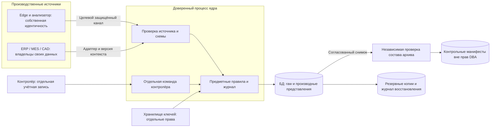

# Доверие к истории и восстановление после сбоя

Дата: 25 сентября 2026. Роль №1, GPT Astra. База проверки кода: `feat/backend-event-journal@a1e8d87`. **Статус: модель спроектирована для review; существующая защита отдельных записей повторно проверена; контроль полноты архива и полное восстановление не реализованы.** Дополнение к [ADR-001](../adr/001-core-architecture.md), [модели оснований](evidence-model.md) и [адресному пересмотру](evidence-graph.md).

## 1. Объяснение без специальных терминов

Нужно ответить на четыре разных вопроса:

1. **Кто прислал запись?** Система контроля входит под своей учётной записью; автор решения контролёра определяется отдельно.
2. **Изменили ли содержимое записи?** Шифрование с проверкой подлинности обнаруживает изменение защищённых байтов и связанных метаданных.
3. **Все ли ранее сохранённые записи остались?** Проверка каждой имеющейся записи не обнаружит запись, которую целиком удалили. Для этого нужен независимый контрольный список.
4. **Можно ли восстановить работу?** Контрольный список обнаружит пропажу, но не вернёт данные. Нужны резервные копии, ключи и проверенная процедура восстановления.

«Свидетельство» здесь — принятое сообщение источника. Защищённое сообщение «царапина обнаружена» доказывает сохранность сообщения, а не физическую истинность царапины. Неверную идентификацию, плохую камеру и ошибочное решение разбирают предметные правила и люди.

## 2. Требования и границы доверия

Постановка §3.4, стр. 7 требует раздельного хранения исходников/проекций, новых записей для исправлений, разграничения доступа, шифрования, отделённых ключей и контроля целостности. На демонстрации требуется предотвращение изменения записи **либо** обнаружение вмешательства; резервирование, восстановление и границы защиты должны быть описаны. Критерий ИБ/аудита на стр. 3 критериев оценивает работающие механизмы. Дополнительный криптографический критерий требует реализованный постквантовый/гибридный сценарий; AES-GCM и смена ключа его не закрывают.

**Допущение пилота:** приложение и держатель ключей не скомпрометированы; оператор БД потенциально может ошибиться или намеренно вмешаться. Независимый архив/проверяющий находится в том же закрытом контуре, но имеет отдельные права и администратора. Возможность разделения должна подтвердить роль №2. Если один человек может менять БД, архив, ключи и журнал проверок, независимость отсутствует.

Схема — целевая: HTTP-аутентификация, пользовательский RBAC, TLS, загрузчик secrets, независимый архив и backup-job в текущем backend отсутствуют. Есть проверка соответствия входного `source_id` идентичности, которую будущий транспорт передаст сервису. Сам параметр `authenticated_source_id` не аутентифицирует сетевого клиента.

| Участник | Целевое право | Ограничение |
| --- | --- | --- |
| Источник контроля/станок | Отправлять события своего source_id и получать квитанции | Не выбирает автора решения и не выдаёт released |
| Контролёр | Читать доступные основания, создавать решение по актуальной ревизии | Не редактирует исходный сигнал; новая оценка — новая запись |
| Мастер/технолог/руководитель | Чтение по своей области; команды только по назначенным правам | Кнопка интерфейса не заменяет разрешение сервера |
| Runtime-роль БД | INSERT/SELECT raw и версий, изменение только производных таблиц | Не владеет схемой, не отключает триггеры, не запускает миграции |
| Мигратор/DBA | Отдельное обслуживание и восстановление | Не используется как runtime; технически способен обойти SQL-ограничения |
| Держатель ключей | Выдача допустимых версий, резервирование и отзыв по регламенту | Ключи не лежат вместе с кодом/дампом; доступ к ключу и БД позволяет читать raw |
| Проверяющий архива | Читать согласованный набор, сохранять контрольный манифест отдельно | DBA не должен переписывать уже принятый эталон |

Администратор интерфейса не получает автоматически право принимать производственные решения. Ссылки в B не должны обходить права на исходники/медиа. Отказ доступа отличается от отсутствия доказательства. Владельцев ключей, сроки аудита административных действий и способ аутентификации согласует пилот.

## 3. Реализованные механизмы и контрпример

| Свойство | Код / проверка | Точная граница |
| --- | --- | --- |
| Исходные байты зашифрованы AES-256-GCM | `backend/app/adapters/protection.py`, `test_protection.py` | Ключи внедряются в память; штатная загрузка secrets отсутствует |
| Метаданные связаны с ciphertext через AEAD | `_aad()` включает record_id, envelope, received_at, digest, исходную квитанцию, профиль и ID/версию ключа | Индексируемые поля открыты; подлинность проверяется при открытии защищённой записи |
| Подмена тела, метаданных и неверный ключ обнаруживаются | `test_corruption_and_wrong_key_are_detected`, `test_record_metadata_is_authenticated` | Это не подпись контролёра и не защита от держателя ключа, способного создать новый корректный пакет |
| Обычные UPDATE/DELETE/TRUNCATE raw блокируются | Миграция `0001_event_journal.py`, `test_append_only_guards_block_modification_even_for_owner` | Владелец БД может отключить триггеры; отдельный тест проверяет такую подмену перед duplicate ACK |
| Runtime-роль не отключает триггеры | `test_writer_cannot_disable_guards`; права fixture | Боевое развёртывание прав ещё предстоит |
| Изменение истории и исходника атомарно | `test_projection_failure_rolls_back_raw_event`, `test_history_failure_rolls_back_raw_current_state_and_versions` | Проверены исключения до commit, не потеря диска или восстановление backup |
| Replay проверяет выбранные raw и восстанавливает текущую проекцию | `_fact()`, `test_tampered_fact_blocks_new_ingestion_and_replay`, `test_replay_repairs_mutable_projection_from_authenticated_facts` | Полноту выборки не доказывает; старые снимки криптографически не аутентифицированы |
| Смена ключа сохраняет чтение старых записей | `test_key_rotation_keeps_old_records_readable` | Нужен старый ключ; потерянный ключ не восстанавливается из ciphertext |

**Контрпример:** `_facts()` сначала отбирает строки по открытым `item_id` и `identification_status`, затем проверяет AEAD. Если привилегированный нарушитель перепривяжет строку, она может не попасть в выборку прежнего изделия. AEAD обнаружит изменение при открытии этой строки, но replay прежнего изделия не обязан её открыть. Полностью удалённую запись он тоже проверить не сможет.

`get_history()` читает готовый снимок без повторной проверки raw. Нельзя подписывать такой ответ «целостность всех оснований проверена». Текущий snapshot восстановим replay при сохранных полных исходниках; исторический snapshot не становится проверенным автоматически. Неизменяемые решения/B, когда появятся, требуют собственного контроля целостности и полноты.

## 4. Выбор контроля полноты: отдельное предложение

| Альтернатива | Польза | Цена / как ломается |
| --- | --- | --- |
| Права, триггеры, AEAD и обычные backups | Покрывает случайные правки и многие действия runtime | DBA может удалить строку или откатить БД; backup без доверенного ориентира не доказывает актуальность |
| Цепочка хешей/дерево в той же БД | Обнаруживает несогласованную правку, допускает эффективные доказательства включения | Можно удалить хвост и заменить локальный корень; хеш рядом с записью не создаёт независимого доверия |
| **Манифест согласованного снимка в независимом архиве** | Обнаруживает удаление, перепривязку и откат закреплённых записей | Отдельное владение, полное сканирование пилота, окно между приёмом и фиксацией; манифест не является копией данных |

**Предварительный выбор:** третий вариант поверх существующей защиты, для ограниченного эксперимента после review. Манифест — список «какие записи и версии здесь были, с какими контрольными значениями». Текущая квитанция `accepted` означает commit БД, а не независимое закрепление или резервирование. Новое значение квитанции требует согласования.

### Протокол для согласования

1. Независимый проверяющий получает согласованный снимок **всех** raw, включая unresolved и записи без изделия. В PostgreSQL возможен read-only REPEATABLE READ для снимка. Это другой сценарий, чем изменяющая READ COMMITTED-транзакция приёма.
2. Для каждой записи сохраняются record_id и хеш полного защищённого пакета с метаданными, включая поля выборки. Каноническое представление, кодирование бинарных полей и версия формата фиксируются до реализации; простой конкатенации строк недостаточно. Архиву для сравнения хешей не нужен plaintext.
3. Элементы сортируются по стабильному ключу. Манифест фиксирует число записей, ID экземпляра журнала, версию формата, ID снимка, предыдущий принятый манифест и корневой хеш. Архив хранит сам список или неизменяемый объект с ним, а не только число строк.
4. Архив назначает собственный монотонный номер подтверждения и защищает манифест от перезаписи. Для переносимой проверки возможно подписание отдельным ключом архива; профиль и управление ключом требуют выбора. Одна подпись не защищает от подстановки старого подписанного снимка: последний номер должен быть известен вне БД.
5. Последующий снимок должен содержать все ранее закреплённые неизменяемые записи/версии с прежними контрольными значениями. Новые записи допустимы. Пропажа/изменение — отказ проверки с ID; автоматическое «обнуление эталона» запрещено. Для сверки backup именно со снимком проверяются точный набор и соответствующая точка восстановления.
6. Различать «commit выполнен», «независимо закреплено» и «восстановимо из проверенной копии». Интервал фиксации, допустимый возраст проверки и действия при недоступности архива согласуются с эксплуатацией. Неподтверждённая полнота видна явно.

`received_at <= T`, `MAX(id)` и последний выданный sequence не являются точным списком коммитов: транзакции могут завершиться в другом порядке. Манифест определяет снимок явным набором. Сравнение с живой БД допускает новые элементы, но не пропажу закреплённых. Исторические версии, решения, B и версии контекста включаются отдельными типизированными наборами по мере реализации; изменяемые проекции сравниваются с указанной версией, а не с любым прошлым хешем.

### Цена и предел обещания

- Полный манифест — O(N) чтений/хеширования плюс O(N log N) сортировки, если порядок не даёт индекс; хранение списка O(N). Частые полные снимки растущего журнала дороги. Инкрементальные деревья/пакеты — вариант после измерения и доказательства commit-границы.
- Удаление **до первого независимого закрепления** может остаться незамеченным. Устойчивая история отправок источника помогает сверке, но ещё не реализована и не доказывает физическую истинность наблюдения.
- Закреплённое удаление обнаруживается при следующей проверке; непрерывной гарантии нет. Сбой проверяющего не выдаёт успешный отчёт; возраст последней проверки наблюдаем.
- Хеш не восстанавливает raw и не расшифровывает его. Нужны отдельно backups и ключи. Подмена и данных, и независимого эталона вне принятой модели доверия.
- Захват приложения/ключей позволяет создать корректно защищённую ложную запись. AEAD не доказывает, какой человек физически действовал; RBAC не делает захваченное ядро доверенным.

**Условие пересмотра:** нет независимого владельца/хранилища — не обещать защиту от DBA. Полное сканирование превышает бюджет — сравнить инкрементальный манифест и WORM-хранилище с эталоном. Нужна гарантия каждой принятой записи без окна — требуется новый ADR квитанции и поведения при отказе независимого контура.

## 5. Ключи и материалы

**Сейчас:** случайный 96-битный nonce, 256-битный AES-ключ; format/profile/key_id/key_version в пакете. Неизвестный профиль и отсутствующий ключ дают разные ошибки. Тестовые ключи случайные, только в памяти. Лимит числа шифрований на версию ключа, KMS, резервирование ключей и автоматическая ротация не реализованы. Для промышленного допуска нужны политика объёма/срока использования ключа и проверка её соблюдения.

**Предложение:** отдельные учётные данные для транспорта, шифрования raw, пользователей и подписи архива. Новые записи используют новый активный ключ, старые читаются старым — это адаптер поддерживает. Старую версию не удаляют до истечения срока хранения всех зависимых данных и копий. Резерв ключей защищён отдельно от backup БД; доступ и восстановление фиксируются в административном аудите.

Смена профиля/перешифрование — новый защищённый объект с отсылкой к оригиналу и доказуемым соответствием содержимого, не UPDATE исходной истории. Процесс пока отсутствует. Ротация не делает ранее раскрытые данные секретными задним числом. Недоступный ключ означает «не можем прочитать/проверить», а не «запись точно подменили».

Медиа в нашем примере нет. Если появятся: срок хранения, идентификатор, хеш, доступ и backup связываются с B; потерянное фото не показывается доступным. Необязательное фото и обязательное по конкретному маршруту основание различаются. Истечение срока хранения не должно молча разрушать обещанную проверяемость решений.

## 6. Восстановление: проект процедуры

**Проблема:** запуск БД после аварии ещё не означает восстановление истории, на которую опирались решения и внешние результаты. Числа RPO (допустимая потеря данных) и RTO (допустимое время восстановления) не заданы заказчиком; транзакции не делают их нулевыми.

Предлагаемый порядок для изолированного учебного восстановления, затем пилота:

1. Зафиксировать инцидент и внешние подтверждения. Приостановить новые решения о выпуске и отправку ERP-результатов для непроверенной области; источники следуют регламенту устойчивой очереди. Сохранить повреждённую копию для разбора.
2. В отдельной среде восстановить backup и, если настроено, WAL до выбранной точки. Указать версию схемы, точку восстановления и неизвестный хвост. Копирование отдельных таблиц без общего снимка непригодно; стратегия покрывает БД и согласованные версии внешних объектов.
3. Получить нужные версии ключей и обработчиков. Проверить ключи по контрольным записям всех требуемых версий. Потерянный ключ не заменяется новым с прежним ID.
4. Сверить закреплённый набор с независимым архивом, затем проверить AEAD и соответствие метаданных содержимому всех raw, включая unresolved. Это две разные проверки. Отсутствие записи/версии/материала регистрируется как пробел.
5. Решения, B и старые снимки восстановить как исторические объекты. Текущие проекции вычислить отдельно по нужным версиям правил/контекста и сравнить с эталоном. Replay не принимает решения и не повторяет команды станку. Текущий `replay()` покрывает только историю/операции, не весь этот шаг.
6. Сверить источники и внешнюю ERP. Неподтверждённые отправки повторять с исходными ID. Получатель дедуплицирует и не применяет старую версию поверх новой. Старый backup может вернуть уже доставленные сообщения outbox: локально потерянный ACK не означает, что ERP ничего не приняла.
7. Проверить дубли, пробелы, неизвестности, связи и контрольный маршрут. ОТК и эксплуатация подтверждают возобновление в проверенной области. Сохранить протокол с фактическими потерями, длительностью и расхождениями.

**Контрпример:** источник получил accepted и удалил локальную копию; после потери диска БД восстановили из более старого backup. Повтор не гарантирован. Даже если сырой JSON найдётся и будет принят снова, новый record_id/received_at не восстановит первоначальные основания решения. Нужны доверенные оригинальные записи/копии либо явно оформленный пробел и реконструкция; новое принятие нельзя выдавать за сохранённую прежнюю историю.

Периодический backup дешевле, но имеет окно потери; backup + архив WAL сокращает его при корректной доставке архива; реплика ускоряет переключение, но может повторить ошибочное удаление и не заменяет независимую копию. Предварительное направление — backup + WAL и отдельный резерв ключей, с выбором RPO/RTO после обследования. Это проект, не настроенная инфраструктура.

## 7. Проверки и фактический запуск

В этой сессии повторно запущены существующие тесты из `backend/`:

| Команда | Результат |
| --- | --- |
| `.\.venv\Scripts\python.exe -m pytest tests/test_protection.py tests/test_source_boundary.py` | **11 passed**; шифрование, метаданные, ключи, source_id |
| `.\.venv\Scripts\python.exe scripts/test_postgres.py` | **32 passed, 68 deselected**; PostgreSQL, обе миграции, runtime-роль, повторы, откаты, история и вмешательство |

Docker Engine первоначально был недоступен; после `docker desktop start` запуск выполнен успешно. Изолированный Compose-проект `qc-journal-test-8c8f4d41b5de` с контейнером, сетью и томом удалён тестовым скриптом. Это **43 повторно прошедшие проверки существующего кода**, не новые тесты манифестов, RBAC или аварийного восстановления. 100 тестов — результат прежнего полного прогона, здесь повторена указанная часть.

Предлагаемые проверки следующего эксперимента; ожидания не считаются выполненными:

| ID | Независимый вход/воздействие | Ожидаемый результат |
| --- | --- | --- |
| S01 | Закрепить R1/R2, привилегированно удалить R2 вместе с мешающими зависимостями в тестовой БД | Сверка показывает отсутствующий R2; успешная AEAD-проверка R1 не даёт «полнота подтверждена» |
| S02 | После закрепления изменить item_id/identification_status R2, исключив его из per-item replay | Полная проверка набора/пакета обнаруживает изменение; локальный replay не используется как оракул полноты |
| S03 | Подставить старый корректно подписанный манифест и старую БД | Независимо известный последний номер обнаруживает откат; локальный максимум недостаточен |
| S04 | Создать R3 после снимка и одновременно проверять R1/R2 | Новая запись допустима; R1/R2 не пропали. Живая БД не обязана точно равняться старому снимку |
| S05 | Остановить архив после commit новых событий | Возраст проверки/незакреплённый хвост виден; квитанция БД не объявляется подтверждением архива |
| S06 | Backup содержит записи под двумя ключами; восстановить лишь новый ключ | Недоступность старого ключа, неполная проверяемость; новый ключ под старым именем даёт ошибку AEAD |
| S07 | Восстановить backup до принятого решения/ACK ERP | Обнаружить пробел и сверить внешние подтверждения; автоматическое повторение решения/понижение версии ERP недопустимы |
| S08 | Восстановить backup + ключи + версии в чистую среду | Сверка состава, AEAD, исторических ссылок и текущего replay; записаны измеренные RPO/RTO и открытый хвост |

S01–S08 требуют согласованного эксперимента. Выполненные SQL-откаты не доказывают S08. Дополнительные баллы за долгосрочную криптографию требуют отдельного реализованного профиля/сценария.

## 8. Передача роли №2 и следующий результат

1. Кто отдельно владеет БД, ключами и архивом? Реально ли исключить перезапись эталона администратором БД?
2. Каковы сроки хранения raw, решений, медиа и ключей; есть ли независимые backup/WORM/WAL-средства?
3. Какой RPO/RTO нужен участку и кто разрешает возобновление?
4. Как долго edge хранит событие после ACK? Можно ли сверить подтверждённые отправки после восстановления старого backup?
5. Что ERP делает с повтором, устаревшей версией и сообщением о неполной истории?
6. Каковы штатные аутентификация, роли, защищённые каналы и ручной контроль при отказе центра?

**Следующий результат №1:** после review выбрать эксперимент полноты S01–S05 либо восстановления S06–S08 и уточнить ADR границы accepted; независимо — оценить стоимость replay/версий и барьера адресного пересмотра. **Следующий результат №2:** включить владельцев, сроки, RPO/RTO, действия edge/ERP и ОТК в enterprise-pilot. Демонстрационный контраст: «изменённую запись обнаружили; удалённую находим сверкой с независимым списком; восстановление показываем отдельно».
