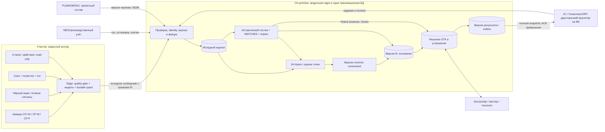

# EFQA: единая цепочка контрольной точки, свидетельства и решения

Статус 26.09.2026: **проектная общая схема двух ролей, редактор роли №2; роль №1 проверяет гарантии ядра, транзакции, границы защиты и жизненный цикл B**. Отдельный сквозной **синтетический прототип** объединён в ветке `feat/unified-evidence-chain`; он не является пилотом на предприятии. Эта схема следует PDF постановки §2.1–5.3, [DP-01](decision-protocol.md), [модели оснований](evidence-model.md), [Evidence Graph](evidence-graph.md), [пилоту роли №2](enterprise-pilot.md), [камерному контуру](camera-ai-design.md) и [транспортной передаче](../role2-dp01-handoff.md). При конфликте семантики DP-01 и v0.2 решение принимают обе роли, а не скрыто меняют источник.

## 1. Границы и единый маршрут

Для защиты **условная сборка кронштейна с вставкой**, два участка/оператора. Сигнал `camera-5: assembly-001, surface-mark` — наблюдение источника, не доказанный дефект или решение. Синтетический пример не доказывает точность реальной камеры. Утверждения о несовместимом составе или свойствах материала требуют других методов контроля. Утверждённая QMS с аудитом остаётся сильной альтернативой; EFQA может стать её модулем. Если настроенная QMS обеспечивает тот же B/late/unknown дешевле, выбирать её и адаптеры.

| Шаг | Владелец | Данные и действие | Отказ / подтверждение |
| --- | --- | --- | --- |
| 1. Контекст | ERP — заказ; технолог — маршрут и точки; PLM — **проектный** состав; MES — **фактический** run/установка | Адаптер сохраняет версии, внешние ID и область применения. Резервирование не равно установке | Неизвестная revision/ID/полнота означает неизвестный знаменатель контроля, а не пустой маршрут |
| 2. Съёмка/«чёрный ящик» | Допущенная камера, метод/аналитик, локальный оператор | Скан экземпляра, участок/run/цикл, качество и область; source/event ID, occurred_at | Нет изображения, света, известной области или run — missing/not_assessable/unresolved, не «годно» |
| 3. Edge | АСУ ТП + ИТ | Устойчивая очередь, local ACK после записи, повтор с тем же ID, медиа отдельно по профилю | Связи нет — конечный буфер и ручной регламент; нет права выпускать по edge-индикации |
| 4. Приём | Служебный источник + ядро | Аутентификация source_id, проверка конверта 1.0 и типа, `(source_id,event_id)` + тело, raw c `received_at` | Повтор возвращает исходную квитанцию; тот же ID с другим телом — конфликт; неверный пакет не принимается |
| 5. История и граф | MES-владелец связей + ядро | Операции, фактический/исторический PART_OF, наблюдения, WATCHES отсутствующих точек, пути impact | Нет пути без утверждения полноты — не доказана независимость; большой охват расширяет review |
| 6. Анализ | Версия правил/метода ядра | Эффективное качество, до/после сопоставимой области, версии гипотез и противоречия | Совпадение с оператором/станком по времени — обстоятельство, не установленная причина |
| 7. Основания | Ядро | Неизменяемая версия B и контекстная ревизия; выдать B контролёру | Новый факт создаёт новый B; нельзя добавить позднее событие в старое B по раннему occurred_at |
| 8. Человек | ОТК | Отдельные confirm/reject/request_check, после доработки resolve/reopen, затем disposition | Команда со старой ревизией отклоняется; повторы команд не принимают новые решения |
| 9. Наружу | Ядро + ERP-адаптер | Полный snapshot, версия и ID; ERP сохраняет inbox и применяет только новую версию | ACK — устойчивая запись и применение/отклонение устаревшей версии, не физическая локализация изделия |

## 2. `basis_id` — ссылка, не контейнер данных

`basis_id` идентифицирует **неизменяемый объект B**. В строку ID нельзя зашифровать всю историю; каждое решение хранит ссылку на точную версию B. B создаётся по согласованному контексту и после принятия решения не меняется. Для системы важно различать snapshot прочитанного тогда и отдельный повтор вычисления прежними версиями правил (старый исполняемый пакет может быть недоступен).

Неизвестность B — не только значения `null`: если не импортирована версия маршрута, нет proof полноты состава или старого исполняемого пакета, формируется явная причина ограничения проверки. Пустой список противоречий при неполных входах не доказывает, что противоречий нет. Для проверки B1/B2 человек должен видеть роль каждого исходника, момент серверного приёма и известную тогда область отбора.

| Что должен содержать B | Как фиксируется в схеме / прототипе | Нельзя подменять |
| --- | --- | --- |
| Точные исходные события | `inputs[]`: серверный record ID + source/event ID + digest + occurred/received, роль каждого входа | Нельзя восстановить B только фильтром по времени |
| Версия маршрута и плана контроля | `pinned_versions.route`, `control_plan`, `work_order` + цикл/ревизия | `latest` не читает прежнее решение |
| Версия проектного и фактического состава | `pinned_versions.design_composition`, `factual_composition`; ID утверждений установки и доказательство полноты в graph path | CAD BOM не доказывает физическую установку; ID snapshot не доказывает правдивость владельца |
| Версия анализатора и метода | `analyzer_versions[]` по каждому исходнику, версии recipe/rules/processor в `pinned_versions` | Одна общая версия «на сейчас» не объясняет старые сигналы |
| Противоречия | `contradictions[]` с checkpoint и точными ID обоих наблюдений; входы помечены `contradictory` | Нельзя выбросить отрицательное наблюдение при позднем положительном |
| Неизвестность | `unknowns[]`, `blockers[]`, `completeness[]` по каждой применимой точке/циклу, информация о недоступном медиа | Отсутствие сигнала не `no_defect_signs`, неизвестная причина не ошибка оператора |
| Исключённые сведения | `excluded_inputs[]`: исходные ID и **непустая причина**; например другой цикл | Нельзя незаметно фильтровать старый факт для получения «чистого» вывода |
| Предыдущие решения | `previous_decisions[]`: ID, действие, автор, время, прежний basis_id, supersedes и версия контекста | `last decision` не является стабильной ссылкой |
| Почему это изделие затронуто | `impact.policy`, composition snapshot, путь source → компонент → историческая/текущая сборка, coverage | Путь информационной зависимости не доказывает физическую причину |

В `contracts/openapi.yaml` v0.4 поля формализованы; `GET /api/v2/bases/{basis_id}` предъявляет B и требует права. В пилотном backend объединены реальный raw record, graph impact и quality B внутри общего транзакционного guard. **Сохранение расширенного B реализовано и проверено на синтетическом сквозном прогоне**; извлечение полного контекста реальных ERP/MES/PLM и автоматическое доверие к нему **не подтверждены**. Прототип прямо отражает неизвестность версии/полноты вместо фиктивной подстановки.

## 3. Evidence Graph действительно влияет на контекст

Смысл графа — типизированные отношения, а не отдельная СУБД. Роль №1 ранее проверила reachability в отдельном скрипте; в общей цепочке используется **та же функция** `app/domain/evidence_graph.py`: исторические/current связи экземпляров, множественные пути и unknown fallback. Подтверждённый владельцем снимок фактического состава позволяет исключить независимую сборку **лишь в пределах снимка и политики impact-v1**. Отсутствие proof, current-cycle/conflicting parents или неизвестный ID делает охват открытым. Новая фактическая установка повторно связывает уже принятый исходник компонента без нового приёма исходника. Это не объединяет физические дефекты между источниками.

Индекс точных использованных B недостаточен: R11 не входил в B1. Для новой контрольной точки нужен WATCHES/область ожидания; для компонента — исторические родители; для unknown — ограничение участка, применимое и к будущим изделиям. Встроенный первый проход сохраняет пути для текущего каталога и консервативно блокирует выпуск при неизвестности; **полное устойчивое хранение WATCHES/межиздельных scope constraints с полномочиями снятия — следующая поставка роли №1**. Дорогой общий guard пилота сериализует независимые изделия; его нельзя выдавать за горизонтальное масштабирование.

### Матрица источников истины — проект для обследования

| Объект | Владелец проекта пилота | Какой снимок использует ядро | Что остаётся спорным |
| --- | --- | --- | --- |
| Заказ/список экземпляров | Планирование/ERP (эмулятор в M0) | external ID + revision + applied mapping | Сверить конфигурацию 1С и серийный учёт с владельцем |
| Применимый маршрут/обязательные точки | Утверждающий технолог и его система | ID и точная версия/цикл и область применимости | ERP может переносить, но не утверждать новое требование |
| Проектный BOM | PLM/КОМПАС и владелец чертежа | version + позиции/тип, без заявления установки | Файл без геометрии не доказывает взаимозаменяемость |
| Фактическая установка/снятие | MES/производственный учёт + мастер | версионированное утверждение и граница выгрузки | Сначала полнота, затем узкий review |
| Run/действия/станок | MES/терминал и PLC/SCADA в read-only режиме | конкретный run, источник, time quality | Совпадение во времени не есть вина оператора |
| Результат камеры | Допущенный внешний источник | raw + метод/качество + media availability | Факт сообщения не доказывает свойства металла |
| Подтверждение дефекта/выпуск | Уполномоченный ОТК | неизменяемые D/P и B, серверные автор/время | ERP application ACK не решение ОТК |
| Применение результата | ERP-получатель | ACK stream/version/digest и сверка версии | Физическое удержание подтверждается отдельно |

Это **проектное** назначение владельцев, не список реально опрошенных систем предприятия. При использовании 1С:ERP с MES-функциями владелец операции может совпасть с ERP как продуктом, но владение фактом устанавливается отдельно от владения планом. При конфликте ID назначается владелец разрешения и создаётся новое утверждение; raw и старые B не исправляются UPDATE.

## 4. Одна транзакция и три разных подтверждения

Пилот: после guard и dedupe raw + обновление истории/графа + B/review + версия outbox коммитятся атомарно в PostgreSQL. Команда ОТК и её ключ идемпотентности — отдельная транзакция по актуальному B/revision. Внешний HTTP выполняется после commit. При превышении бюджета обхода **rollback и нет accepted**, а источник хранит исходник; частичный успешный охват запрещён. Исторические циклы конечны с visited; конфликт одновременного состава должен оставаться видимой неизвестностью. В новой ветке на синтетике проверен путь «поздняя установка → прежний исходник компонента → сборка». Проверка приёмки T/C всего предприятия остаётся открытой.

1. **Local ACK** edge: пакет записан локально при исправном носителе/ключе; не подтверждение центрального приёма.
2. **Core accepted**: транзакция raw/проекций/outbox завершена; не подтверждение сохранности изображения в отдельном архиве.
3. **ERP applied ACK**: входной snapshot сохранён и атомарно применён/признан устаревшим; не подтверждение физического удержания/доработки и не независимый backup.

`GET /external/v2/quality-state` сверяет текущую версию после lost ACK/V2→V1. Выходная версия растёт при новом публикуемом состоянии, не от polling/ACK/транспортного дубля. Старый released остаётся в истории после late, но текущий `release_allowed_now` может стать false; мастер выполняет физическое ограничение вручную.

## 5. KPI: определение, исправление и граница

В reference quality-срезе `inspected_items` был привязан к **активному** циклу. После открытия rework cycle значение могло упасть с 1 до 0 до нового осмотра, хотя это изделие уже проверяли в рассматриваемой когорте. **В прототипе исправлено**: `inspected_items` считает distinct надёжно идентифицированные изделия с хотя бы одним оценимым good-наблюдением в доступной истории выбранной когорты; `missing/not_assessable` текущего цикла показываются отдельно и **не разрешают выпуск**. Это выбранная lifetime-семантика для пилотной когорты без временных фильтров; при фильтре по периоду надо дополнительно определять период по occurred/received и не переносить старые проверки в новый цикл.

`confirmed_defects` — уникальные актуально подтверждённые логические карточки, включая устранённые; `open_confirmed_defects`, `resolved_confirmed_defects`, `confirmed_nonconforming_items`, `rework_operations` и наблюдения показываются раздельно. Повтор `(source_id,event_id)` не создаёт raw, нового B/review/outbox/KPI; два разных знака одного сообщения — два кандидата, два сигнала с одним стабильным source/ref в одной области — один кандидат. До признания межстанционной физической идентичности нельзя автоматически сливать разные source/item/region. Отрицательное наблюдение и исходное событие без уверенной идентификации не дают надёжного знаменателя.

В исходном PDF отраслевой и технический блоки имеют разные углы оценки. Эти определения и проверки **не дают автоматически баллов, процента снижения брака или вероятности предотвращения аварии**.

## 6. Доверие и честные границы прототипа

**Реализовано и проверено на текущей ветке/через интеграционные проверки:** шифрование и аутентификация отдельных raw-записей AEAD; обнаружение изменения сохранённого payload/проверяемых метаданных; запрет UPDATE/DELETE/TRUNCATE для обычной записи в журнале приложения (триггеры/ограниченные права); отдельное сохранение старых B/решений; аутентификация служебного источника на HTTP-границе демонстратора и запрет роли источника принимать решение контролёра. Проверка источника не подтверждает физическую идентичность детали.

**Нельзя утверждать:**

- что администратор БД/хоста не может удалить или подменить историю: привилегированный доступ обходит права и триггеры;
- что удаление **целой** raw-записи либо всех записей обнаруживается текущим AEAD: отсутствующая запись не предъявляет tag для проверки; требуются независимые контрольные точки полноты/резервный архив;
- что проверено восстановление B, человеческих решений и outbox после потери сервера: локальный тест рестарта ERP и контейнера БД не является disaster restore;
- что шифрование или наличие хеша рядом с записью доказывает **полноту истории**, её истинность или фактический состав изделия;
- что старый исполняемый анализатор/архив медиа всегда доступен по одной version-строке;
- что синтетическая камера или фиктивное утверждение состава валидированы на производстве.

Ротация ключей и отказ при недоступном старом ключе проверены для отдельных записей в backend-тестах. Независимая подпись/манифест полноты, отдельный failure domain, restore drill с ключами, доверие администратору и подтверждение физического состава **предстоят**. Это явно отделено от транспортных и криптографических механизмов. RPO/RTO пилота — проектные допущения.

## 7. Проверка и план передачи

Синтетический сквозной прогон настоящих HTTP/PostgreSQL и отдельного ERP HTTP находится в `backend/tests/integration/test_unified_chain.py`: два участка, поздний сигнал, B1/B2, дубль, гипотезы пока unresolved, rework-cycle, resolve, выпуск, полное сообщение, ACK и путь компонента к сборке. В текущей ветке **реализованы** единый источник истины для тестовой структуры и базовая цепочка; дополнительные механизмы распределены в [плане роли №1](role1-completion-plan.md). Вся целевая on-prem/edge система, полное CV и предприятие **спроектированы**, не проверены на площадке.

Воспроизводимый прогон из корня на Python 3.11 и тестовой PostgreSQL 17 (новая БД с суффиксом `_test`, доступом к CREATE SCHEMA/ROLE): `python -m pip install -r backend/requirements.unified.lock.txt`, затем `PYTHONPATH=backend:. TEST_DATABASE_URL=postgresql+psycopg://.../efqa_test python -m pytest backend/tests contracts emulator -q`. Новая миграция `0004_unified_chain` применяется fixture в изолированной схеме и по завершении удаляется. CI с одноразовой базой: `.github/workflows/unified-chain.yml`. Нет постоянных секретов в репозитории.

Перед архитектурным freeze роли вместе проходят пример без ИИ, подтверждают ID/метод/состав, правила неизвестности, пределы B и один закрытый перечень архитектурных расхождений. После freeze по [DP-01](decision-protocol.md) выбирают проверяемый M0 без ложной заявки на восстановление центра.
