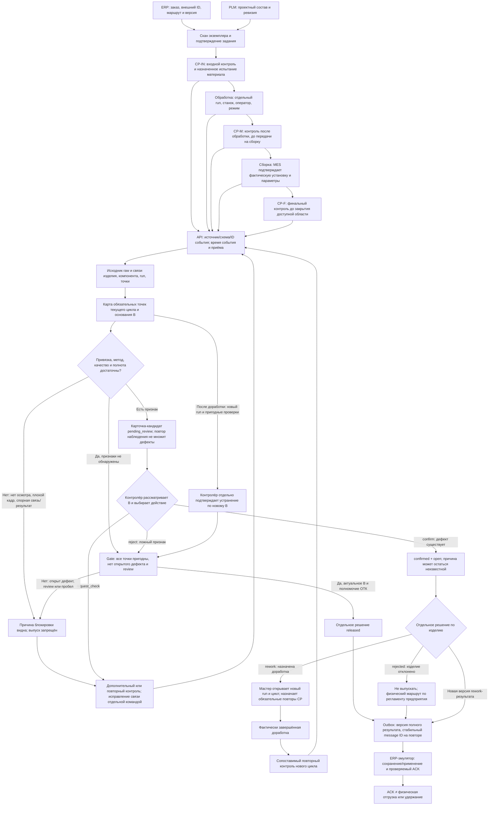

# Полный путь детали через контроль и отбраковку

Схема дополняет **слайды 4–5** [пятиминутной презентации](presentation-5min.pdf). Физические CP-IN/CP-M/CP-F, камеры, испытания материала и edge — **проект производственного пилота** на условной сборке `assembly-001`. Цифровые решения, B, контроль полноты, доработка, повторные осмотры, выпуск и ERP-ACK проверены **в P8 на структурированных сигналах эмулятора**, а не на реальном станке. Деталь не считается бракованной от одного сообщения анализатора.

## Как читать схему без терминов API

1. **Сначала известно, что должно быть проверено.** Технолог утверждает контрольный план; ERP даёт задание/версию, PLM — проектный состав, MES/учёт подтверждает фактическую установку. CP-IN/CP-M/CP-F — точки на выбранном маршруте. Для каждой нужны экземпляр, область, операция, метод и пригодное качество. Камера видит доступную поверхность; свойства материала, внутренние дефекты, посадку и усилие проверяют **другими назначенными методами**.
2. **После каждого шага остаётся исходное свидетельство.** Анализатор сообщает `defect_signs`, `no_defect_signs` либо `not_assessable`. API проверяет источник и дубли: прежние `(source_id,event_id)` с тем же телом не создают новый факт/KPI. Отдельно хранятся время события и серверное время приёма. Состояние станка и действие оператора — обстоятельства, а не установленная вина.
3. **Карта контроля не путает тишину с годностью.** Нет обязательного осмотра → `missing`; плохое качество или неприменимый метод → `not_assessable`; конфликт данных/привязки требует разбора. В этих случаях выпуск запрещён, а повтор или привязка оформляются отдельно с сохранением прежнего raw. Даже при отсутствии признаков по всем снимкам решение о выпуске — **отдельная команда ОТК по актуальному B**, не действие камеры.
4. **Признак не равен браку.** Он открывает карточку-кандидат; два наблюдения одного признака *одним проверенным источником со стабильным `defect_ref`* могут относиться к одной логической карточке. Контролёр вправе запросить проверку, мотивированно отклонить ложный признак (`reject`) либо подтвердить существование дефекта (`confirm`). Причина может остаться `unresolved`. Между разными физическими камерами тождество дефекта не угадывается по одному названию.
5. **Отбраковка изделия — отдельная развилка.** После подтверждения контролёр назначает `rework` либо отдельное `rejected` изделия. `reject` карточки ≠ `rejected` изделия. `rework` ещё не означает, что ремонт выполнен; мастер открывает новый экземпляр операции и новый цикл с закреплёнными обязательными проверками. Перенос старой точки возможен только по утверждённому плану с основанием, автоматически он не происходит.
6. **После доработки нужно доказать устранение.** Новая операция завершена, область повторно проверена пригодным методом, контролёр отдельным решением `resolve` подтверждает устранение. Исторически подтверждённый дефект остаётся видимым, но перестаёт быть открытым. Gate вновь проверяет все требования текущего цикла, противоречия, review и права; только тогда возможно новое `released`.
7. **Результат доходит до ERP без двойного действия.** Каждая новая версия результата сохраняется в outbox; при потере ответа повторяется **тот же** ID/тело. ERP-эмулятор проверяет версию и даёт ACK сохранения/применения. ACK не подтверждает, что деталь физически удержали или отгрузили: за это отвечают мастер/ОТК по штатному регламенту.
8. **Поздний факт не стирает прошлое.** Raw, B и прежнее решение сохраняются; новое свидетельство создаёт новую оценку и `review_required`. Даже если ранее было `released`, текущая допустимость выпуска может измениться. Система уведомляет для пересмотра и публикует новую версию результата, но не выполняет автоматический физический отзыв.

## Решения и ответственность — не перепутать на защите

| Вопрос | Ответ | Кто действует |
| --- | --- | --- |
| Есть признак? | Наблюдение анализатора, версия и качество | Источник/эмулятор; не подписывает выпуск |
| Существование дефекта подтверждено? | `pending_review` → `confirm` / `reject` / `request_check` | Уполномоченный контролёр по закреплённому B |
| Дефект устранён? | `open` → `resolved` после выполненной доработки и повторного контроля | Контролёр; `resolve` отдельно от `confirm` |
| Что делать с изделием? | `rework` / `rejected` / `released` по условиям gate | ОТК принимает решение; мастер исполняет физический маршрут |
| Дошёл ли статус во внешнюю систему? | ACK именно версии результата, а не движения изделия | Worker и ERP-эмулятор; при сбое повтор того же ID |

**Речь на слайде 5 — 50 секунд:** «Наблюдение камеры ещё не брак. При хорошем и полном контроле ОТК может выпустить деталь. При пропуске, плохом кадре или конфликте выпуск запрещён до повторной проверки. При признаке контролёр отдельно подтверждает дефект, отвергает ложный сигнал или просит дополнительный осмотр. Подтверждение ещё не списание: изделие отправляют на доработку либо отдельно отклоняют. После доработки создаются новая операция и цикл контроля, ОТК подтверждает устранение, затем повторно проверяется возможность выпуска. Исходники и прежние основания остаются в истории, результат доставляется в ERP с проверенным ACK».

Источники правил: [DP-01](../../architecture/decision-protocol.md), [P7](../../architecture/p7-remediation.md), [статус P8](../../architecture/p8-pilot-completion.md), [производственный пилот](../../architecture/enterprise-pilot.md).
